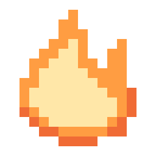
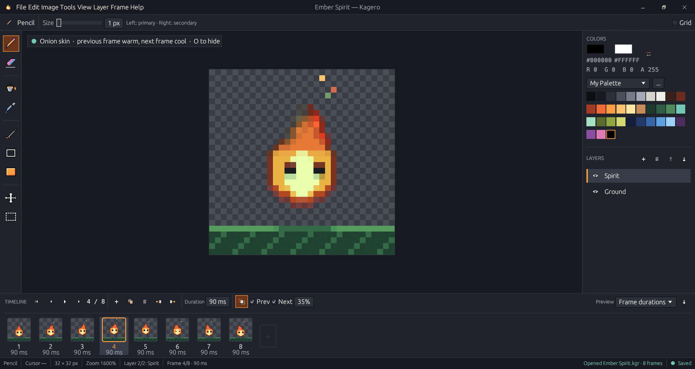
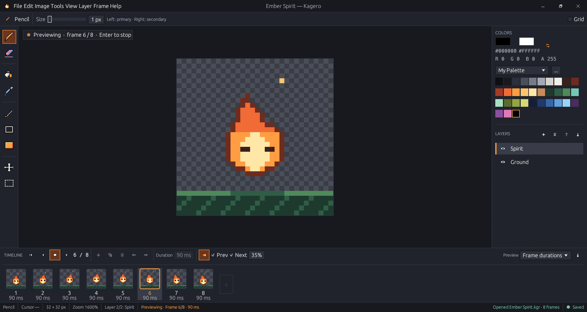
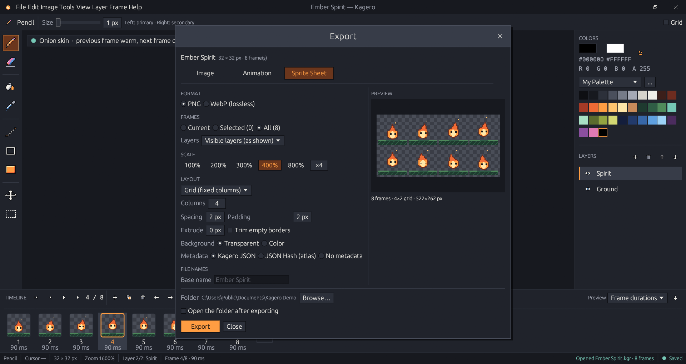

<div align="center">



# Kagero 陽炎

**A pixel-art and sprite-animation editor by Onibi Lab — from the first pixel to a game-ready sprite sheet.**

Version 0.4.0 Beta · Windows 10/11 x64 · Written in Rust · MIT License

[**Download**](https://github.com/senzukisu/kagero/releases/latest) ·
[Documentation](https://kagero.gitbook.io/kagero-docs) ·
[Changelog](CHANGELOG.md) ·
[Report a bug](https://github.com/senzukisu/kagero/issues)

</div>

---

Kagero ("heat haze") is a small, fast desktop editor for pixel art and frame-by-frame
animation. Draw on a pixel-exact canvas, animate with a timeline and onion skin, and
export PNGs, GIFs, animated WebPs and sprite sheets with JSON metadata for your game
engine — all in one small program that runs offline. It follows the familiar workflow of dedicated
sprite editors, but its design, code, icons and font are its own, dressed in the warm,
dark **Kagero Ember** style: a quiet workshop lit by amber light.



<table>
<tr>
<td width="50%"></td>
<td width="50%"></td>
</tr>
<tr>
<td align="center"><sub>Real-time animation preview (<kbd>Enter</kbd>)</sub></td>
<td align="center"><sub>Sprite sheet export with a live preview</sub></td>
</tr>
</table>

## What's new in 0.4.0

- **Everyday comfort:** Canvas Size and a Crop tool, layer opacity, Duplicate Layer,
  Merge Down, layer locks, and **autosave with crash recovery**.
- **Selections:** Lasso and Magic Wand, with add, subtract, intersect and invert. Every
  edit follows the exact shape.
- **Drawing:** Ellipse and Polygon tools, symmetry, dithering, round and custom brushes,
  Fill with tolerance, exact HEX/RGBA entry, and Convert to Palette.
- **Animation:** frame tags to name, loop and export parts of an animation.
- **Export:** animated WebP (lossless, full transparency) and packed sprite sheets.
- **Themes** (Kagero Ember, Night Sakura, Misty Forest, Paper, and your own) and
  **plugins** in sandboxed Lua.
- **An installer** with Start menu and desktop shortcuts, and a program icon.

Everything is in the [changelog](CHANGELOG.md).

## Features

### Draw

- Images from 1×1 to 2048×2048 with a transparent, white or black background
- Pencil, Eraser, Fill, Eyedropper, Line, Rectangle, Filled Rectangle, Ellipse,
  Polygon, Pan and Crop
- Square, round and custom brushes from 1 to 32 px, symmetry (mirror ↔ / ↕) and
  dithering (25 %, checker, 75 %)
- Fill with tolerance, contiguous or global, from the layer or the whole image
- A pixel-exact canvas: nearest-neighbor zoom, a checkerboard where one square is one
  pixel, an optional pixel grid — sharp at every Windows display scale
- Layers with opacity, lock and alpha lock: add, duplicate, merge down, delete, rename,
  reorder and hide
- Canvas Size with an anchor, and Crop
- Undo and redo for every change; autosave with crash recovery

### Select and transform

- Rectangle, Lasso and Magic Wand selections; add, subtract, intersect and invert
- Move (drag or arrow keys), copy, cut, paste, delete and duplicate the exact shape
- Flip horizontal/vertical and rotate 90°/180°/270° — the selection, or the whole
  layer when nothing is selected
- Each operation is one undo step that also restores the selection

### Colors

- Several palettes: create, rename, reorder colors, import and export GIMP `.gpl` and
  HEX files
- Built-in Kagero Ember, Ember, Night Sakura and Misty Forest
- HEX and RGBA entry, click-to-copy HEX, and the 12 most recently used colors
- Convert to Palette with a before/after preview

### Animate

- Frames with their own duration (10–60 000 ms): new, duplicate, delete, reorder
- A timeline with live thumbnails, resizable and collapsible
- Real-time looping preview by frame durations or a fixed FPS
- Onion skin: the previous frame in a warm tint, the next in a cool tint
- Frame tags: named ranges to select, loop in the preview, jump between and export

### Export for games

One Export dialog (<kbd>Ctrl</kbd>+<kbd>Shift</kbd>+<kbd>E</kbd>) with a live preview,
background export, progress and cancel:

| Output | Details |
|--------|---------|
| **PNG** | Pixel-exact, full transparency — recommended for sprites |
| **JPEG** | Quality 1–100, white/black/custom background |
| **WebP** | Lossless with transparency |
| **Animated GIF** | Real frame durations, loop or play once, clean transparency, exact colors (≤ 255) or reduction with optional dithering |
| **Animated WebP** | Lossless, every color and soft transparency, exact durations |
| **Sprite sheet** | Strips, grids or **packed** (smallest sheet, identical frames shared), spacing, padding, trim, extrude, background |
| **Metadata** | Kagero JSON (versioned) or the common JSON Hash atlas format, with frame tags |

- Export the current frame, frames picked in the timeline, a frame tag, or all frames
- Integer scale 100–800 % or any whole number — always nearest neighbor
- Numbered file names (`sprite_0001.png`) and a confirmation before replacing files

### Projects and the rest

- `.kgr` projects (a ZIP of JSON and PNG) keep frames, durations, layers and tags;
  older projects open automatically
- PNG import; safe saving that never leaves a half-written file
- A built-in updater that checks GitHub Releases, verifies the package signature and
  installs with automatic rollback
- Discord Rich Presence through the Discord desktop app, private by default
- Kagero's own title bar, pixel icons and an optional pixel font
- Color themes (four built-in, plus your own as JSON files)
- Plugins: Lua scripts in a sandbox (no files, network or programs), off until you turn
  them on

Everything works offline. Discord and GitHub are never required.

## Quick start

1. Download `kagero-0.4.0-setup.exe` from the
   [latest release](https://github.com/senzukisu/kagero/releases/latest) and run it.
   It installs for your user account (no administrator rights) with a Start menu
   shortcut and, if you like, a desktop shortcut. Prefer a portable copy? Extract
   `kagero-0.4.0-windows-x64.zip` to a folder you own instead.
2. Start Kagero → **Create New** → pick a size → draw.
3. <kbd>Alt</kbd>+<kbd>N</kbd> adds a frame, <kbd>O</kbd> shows onion skin,
   <kbd>Enter</kbd> plays the animation.
4. <kbd>Ctrl</kbd>+<kbd>Shift</kbd>+<kbd>E</kbd> exports a PNG, a GIF, a WebP or a sprite
   sheet.

No runtime or account is needed; Kagero needs an OpenGL 2.0+ graphics driver. Settings,
themes, plugins, autosave copies and the log are in `%APPDATA%\OnibiLab\Kagero`;
uninstalling keeps them. Already have Kagero? **Settings → Updates → Check for Updates**.

<details>
<summary>Verify a download by hand</summary>

SHA-256 sums are in `SHA256SUMS.txt` on each release. The installer and the zip are signed with
[minisign](https://jedisct1.github.io/minisign/); the public key is
[`kagero.pub`](kagero.pub):

```
rsign verify kagero-0.4.0-setup.exe -p kagero.pub
```

</details>

A step-by-step walkthrough: [Your first animation](docs/getting-started/first-animation.md).

## Shortcuts

| Keys | Action |
|------|--------|
| <kbd>B</kbd> <kbd>E</kbd> <kbd>G</kbd> <kbd>I</kbd> | Pencil, Eraser, Fill, Eyedropper |
| <kbd>L</kbd> <kbd>U</kbd> <kbd>Shift</kbd>+<kbd>U</kbd> <kbd>K</kbd> <kbd>P</kbd> | Line, Rectangle, Filled Rectangle, Ellipse, Polygon |
| <kbd>M</kbd> <kbd>Q</kbd> <kbd>W</kbd> · <kbd>C</kbd> | Rectangle Select, Lasso, Magic Wand · Crop |
| <kbd>H</kbd> or <kbd>Space</kbd>+drag | Pan |
| <kbd>X</kbd> | Swap primary and secondary colors |
| Wheel, <kbd>+</kbd> / <kbd>−</kbd> · <kbd>0</kbd> / <kbd>1</kbd> | Zoom · Fit / 100 % |
| <kbd>Ctrl</kbd>+<kbd>Z</kbd> / <kbd>Ctrl</kbd>+<kbd>Y</kbd> | Undo / Redo |
| <kbd>Ctrl</kbd>+<kbd>C</kbd> <kbd>Ctrl</kbd>+<kbd>X</kbd> <kbd>Ctrl</kbd>+<kbd>V</kbd> · <kbd>Delete</kbd> | Copy, cut, paste · clear the selection |
| <kbd>Shift</kbd>+<kbd>H</kbd> / <kbd>Shift</kbd>+<kbd>V</kbd> · <kbd>Ctrl</kbd>+<kbd>R</kbd> | Flip · rotate 90° |
| <kbd>Ctrl</kbd>+<kbd>Shift</kbd>+<kbd>I</kbd> · <kbd>Ctrl</kbd>+<kbd>B</kbd> | Invert selection · selection as brush |
| <kbd>Enter</kbd> · <kbd>,</kbd> / <kbd>.</kbd> | Play / stop · previous / next frame |
| <kbd>Alt</kbd>+<kbd>N</kbd> / <kbd>Alt</kbd>+<kbd>D</kbd> · <kbd>O</kbd> | New / duplicate frame · onion skin |
| <kbd>Alt</kbd>+<kbd>T</kbd> · <kbd>Alt</kbd>+<kbd>,</kbd> / <kbd>Alt</kbd>+<kbd>.</kbd> | New tag · previous / next tag |
| <kbd>Ctrl</kbd>+<kbd>S</kbd> · <kbd>Ctrl</kbd>+<kbd>E</kbd> · <kbd>Ctrl</kbd>+<kbd>Shift</kbd>+<kbd>E</kbd> | Save · export frame as PNG · Export dialog |
| <kbd>F7</kbd> / <kbd>F8</kbd> · <kbd>Ctrl</kbd>+<kbd>,</kbd> | Timeline / side panel · Settings |

All of them: [Keyboard shortcuts](docs/reference/keyboard-shortcuts.md). Every
shortcut can be changed in **Settings → Shortcuts**.

## Building from source

Requirements: Rust stable (1.85+) with the MSVC toolchain on Windows.

```
cargo run                # debug build
cargo test               # all tests (no network, no GUI needed)
cargo build --release    # target\release\kagero.exe (and the updater and installer)
```

Before a commit: `cargo fmt --check` and `cargo clippy --all-targets`. Source builds can
check for updates but never install them; official packages are built and signed with
`scripts\package-release.ps1` ([releasing](docs/developers/contributing.md#releasing)).
The Kagero Pixel font is drawn in `assets/fonts/kagero-pixel.txt` and built with
`python scripts/build-font.py` (needs `fonttools`). The program icon
(`assets/kagero.ico`) is made from the pixel logo with `cargo run --example make_icon`
and embedded by `build.rs` (needs the Windows SDK's `rc.exe`; without it the build
still works, just without an icon).

```
src/core        pixel engine: colors, buffers, documents, frames, selection, palettes
src/editor      editing commands, tools and undo history
src/export      export pipeline: PNG/JPEG/WebP, GIF, sprite sheets, metadata
src/file_io     .kgr projects, PNG, palette files, atomic writes
src/ui          egui interface: canvas, timeline, panels, dialogs, title bar
src/services    updater, installer and uninstaller, autosave/recovery, logging
src/themes.rs   color themes · src/plugins.rs: Lua plugins · src/integrations: Discord
```

More in [Architecture](docs/developers/architecture.md).

## Documentation

📖 **[kagero.gitbook.io/kagero-docs](https://kagero.gitbook.io/kagero-docs)** — built from the
[`docs/`](docs/README.md) folder of this repository.

| Section | Pages |
|---------|-------|
| **Getting started** | [Install & update](docs/getting-started/installation.md) · [Quick start](docs/getting-started/first-animation.md) · [The workspace](docs/getting-started/interface-tour.md) |
| **Draw** | [Tools & canvas](docs/draw/drawing-tools.md) · [Selection](docs/draw/selection.md) · [Colors & palettes](docs/draw/palettes.md) · [Layers](docs/draw/layers.md) |
| **Animate & export** | [Animation](docs/animate/animation.md) · [Projects & import](docs/export/files-and-export.md) · [Export](docs/export/export/README.md) · [GIF and WebP](docs/export/export/animated-export.md) · [Sprite sheets](docs/export/export/sprite-sheets.md) |
| **Reference** | [Shortcuts](docs/reference/keyboard-shortcuts.md) · [Settings & Discord](docs/reference/settings.md) · [Themes](docs/reference/themes.md) · [FAQ](docs/reference/faq.md) |
| **Plugins** | [Plugins and the Lua API](docs/plugins/README.md) |
| **Developers** | [Architecture](docs/developers/architecture.md) · [Project format](docs/developers/project-format.md) · [Sprite sheet metadata](docs/developers/metadata-format.md) · [Services](docs/developers/services.md) · [UI design](docs/developers/ui-design.md) · [Contributing](docs/developers/contributing.md) |
| **About** | [Roadmap](docs/about/roadmap.md) · [Changelog](docs/about/changelog.md) · [How Kagero is made](docs/about/ai-assistance.md) · [License](docs/about/license.md) |

## What's next

Drawing tools that stay inside the selection, saved custom brushes, a larger plugin
API and Kagero Pixel as the default font — see the [roadmap](docs/about/roadmap.md).

## How Kagero is made

Yes — large language models (LLMs) are used in Kagero's development, **but not for all
of the code**. Most often an LLM works as an assistant: helping with code (suggestions,
bug hunting, tests, reviews) and helping with building and publishing releases and
documentation. Decisions about what Kagero is and whether a change goes in stay with
the developer, and every change goes through the same formatting, Clippy and test
checks. More in [How Kagero is made](docs/about/ai-assistance.md).

## Beta notes

Kagero 0.4.0 is a beta. Known limitations:

- Pencil and the shape tools don't stay inside the selection (Fill does).
- Lasso and Magic Wand can't drag the selected pixels; use Rectangle Select or the
  arrow keys.
- Custom brushes last until Kagero closes; they aren't saved.
- The plugin API covers the active layer, the selection and the colors.
- WebP export is lossless only.
- Windows snap layouts don't appear when hovering the maximize button of the custom
  title bar (<kbd>Win</kbd>+arrow keys and dragging to screen edges still work).
- Official packages are Windows x64 only, and Windows SmartScreen may warn because the
  executables aren't code-signed (the release files are signed with minisign).

Found a problem? Please open an [issue](https://github.com/senzukisu/kagero/issues).

## License

Kagero's source code, icons and the Kagero Pixel font are released under the
[MIT License](LICENSE). Third-party components are listed in
[THIRD_PARTY_LICENSES.md](THIRD_PARTY_LICENSES.md). Kagero is not affiliated with
Aseprite, Igara Studio or Discord.

© 2026 Onibi Lab
