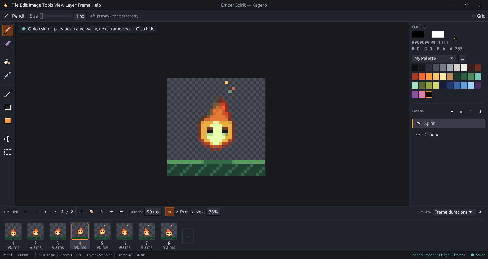
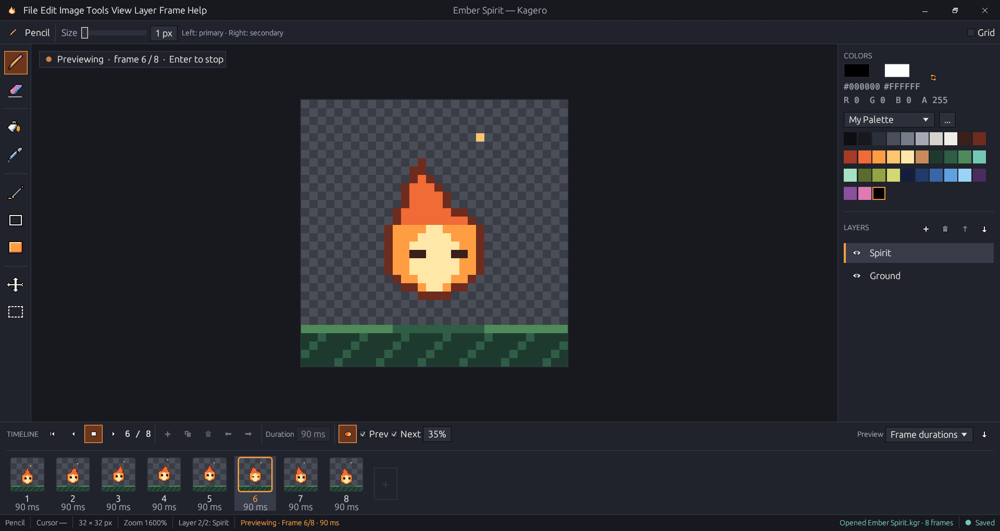
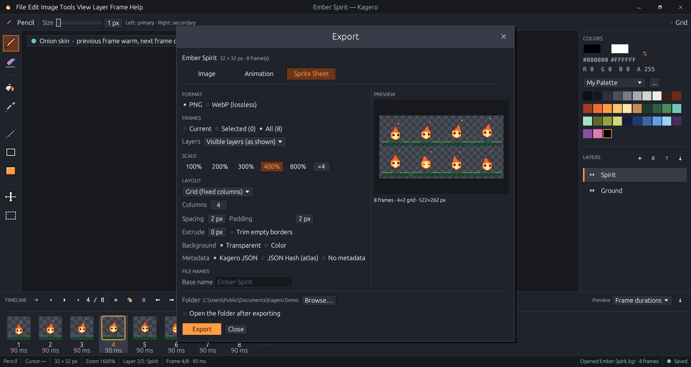

<div align="center">


# Kagero 陽炎

**A pixel-art and sprite-animation editor by Onibi Lab — from the first pixel to a game-ready sprite sheet.**

Version 0.3.6 Beta · Windows 10/11 x64 · Written in Rust · MIT License

[**Download**](https://github.com/senzukisu/kagero/releases/latest) ·
[Documentation](https://kagero.gitbook.io/kagero-docs) ·
[Changelog](CHANGELOG.md) ·
[Report a bug](https://github.com/senzukisu/kagero/issues)

</div>

---

Kagero ("heat haze") is a small, fast desktop editor for pixel art and frame-by-frame
animation. Draw on a pixel-exact canvas, animate with a timeline and onion skin, and
export PNGs, GIFs and sprite sheets with JSON metadata for your game engine — all in
one small program (a 4 MB download) that runs offline. It follows the familiar workflow of dedicated
sprite editors, but its design, code, icons and font are its own, dressed in the warm,
dark **Kagero Ember** style: a quiet workshop lit by amber light.



<table>
<tr>
<td width="50%"></td>
<td width="50%"></td>
</tr>
<tr>
<td align="center"><sub>Real-time animation preview (<kbd>Enter</kbd>)</sub></td>
<td align="center"><sub>Sprite sheet export with a live preview</sub></td>
</tr>
</table>

## What's new in 0.3.6

- **Kagero's own title bar** — flame, menus, document title and pixel-style window
  buttons in one bar. Drag to move, double-click to maximize, resize from the edges.
- **Opens maximized**, filling the screen (and remembers if you prefer a window).
- **Classic font by default**; Kagero's own pixel font is an experimental option in
  Settings → General.

Since 0.3.0: a full export workflow (PNG, JPEG, WebP, GIF, sprite sheets), rectangle
selection, multiple palettes, 31 new pixel icons and a pixel-style interface.
Everything is in the [changelog](CHANGELOG.md).

## Features

### Draw

- Images from 1×1 to 2048×2048 with a transparent, white or black background
- Pencil, Eraser, Fill, Eyedropper, Line, Rectangle, Filled Rectangle, Pan and
  Rectangle Select, with square brushes from 1 to 32 px
- Primary color on the left button, secondary on the right
- A pixel-exact canvas: nearest-neighbor zoom, a checkerboard where one square is one
  pixel, an optional pixel grid — sharp at every Windows display scale
- Layers: add, delete, rename, reorder and hide, with alpha compositing
- Undo and redo for every change

### Select and transform

- Rectangle selection: move (drag or arrow keys), copy, cut, paste, delete, duplicate
- Flip horizontal/vertical and rotate 90°/180°/270° — the selection, or the whole
  layer when nothing is selected
- Each operation is one undo step that also restores the selection

### Colors

- Several palettes: create, rename, reorder colors, import and export GIMP `.gpl` and
  HEX files
- Built-in Kagero Ember, Ember, Night Sakura and Misty Forest
- Click-to-copy HEX, an RGBA readout and the 12 most recently used colors

### Animate

- Frames with their own duration (10–60 000 ms): new, duplicate, delete, reorder
- A timeline with live thumbnails, resizable and collapsible
- Real-time looping preview by frame durations or a fixed FPS
- Onion skin: the previous frame in a warm tint, the next in a cool tint

### Export for games

One Export dialog (<kbd>Ctrl</kbd>+<kbd>Shift</kbd>+<kbd>E</kbd>) with a live preview,
background export, progress and cancel:

| Output | Details |
|--------|---------|
| **PNG** | Pixel-exact, full transparency — recommended for sprites |
| **JPEG** | Quality 1–100, white/black/custom background |
| **WebP** | Lossless with transparency |
| **Animated GIF** | Real frame durations, loop or play once, clean transparency, exact colors (≤ 255) or reduction with optional dithering |
| **Sprite sheet** | Horizontal/vertical strips or grids, spacing, padding, trim, extrude, background |
| **Metadata** | Kagero JSON (versioned) or the common JSON Hash atlas format |

- Export the current frame, frames picked in the timeline, or all frames
- Integer scale 100–800 % or any whole number — always nearest neighbor
- Numbered file names (`sprite_0001.png`) and a confirmation before replacing files

### Projects and the rest

- `.kgr` projects (a ZIP of JSON and PNG) keep frames, durations and layers; older
  projects open automatically
- PNG import; safe saving that never leaves a half-written file
- A built-in updater that checks GitHub Releases, verifies the package signature and
  installs with automatic rollback
- Discord Rich Presence through the Discord desktop app, private by default
- Kagero's own title bar, pixel icons and an optional pixel font

Everything works offline. Discord and GitHub are never required.

## Quick start

1. Download `kagero-0.3.6-windows-x64.zip` from the
   [latest release](https://github.com/senzukisu/kagero/releases/latest).
2. Extract it to a folder you own, for example `%LOCALAPPDATA%\Programs\Kagero`
   (so in-app updates can install).
3. Run `kagero.exe` → **Create New** → pick a size → draw.
4. <kbd>Alt</kbd>+<kbd>N</kbd> adds a frame, <kbd>O</kbd> shows onion skin,
   <kbd>Enter</kbd> plays the animation.
5. <kbd>Ctrl</kbd>+<kbd>Shift</kbd>+<kbd>E</kbd> exports a PNG, a GIF or a sprite sheet.

No installer, runtime or account is needed; Kagero needs an OpenGL 2.0+ graphics
driver. Settings and the log are in `%APPDATA%\OnibiLab\Kagero`. Already have Kagero?
**Settings → Updates → Check for Updates**.

<details>
<summary>Verify a download by hand</summary>

SHA-256 sums are in `SHA256SUMS.txt` on each release. The package is signed with
[minisign](https://jedisct1.github.io/minisign/); the public key is
[`kagero.pub`](kagero.pub):

```
rsign verify kagero-0.3.6-windows-x64.zip -p kagero.pub
```

</details>

A step-by-step walkthrough: [Your first animation](docs/getting-started/first-animation.md).

## Shortcuts

| Keys | Action |
|------|--------|
| <kbd>B</kbd> <kbd>E</kbd> <kbd>G</kbd> <kbd>I</kbd> | Pencil, Eraser, Fill, Eyedropper |
| <kbd>L</kbd> <kbd>U</kbd> <kbd>Shift</kbd>+<kbd>U</kbd> | Line, Rectangle, Filled Rectangle |
| <kbd>M</kbd> · <kbd>H</kbd> or <kbd>Space</kbd>+drag | Rectangle Select · Pan |
| <kbd>X</kbd> | Swap primary and secondary colors |
| Wheel, <kbd>+</kbd> / <kbd>−</kbd> · <kbd>0</kbd> / <kbd>1</kbd> | Zoom · Fit / 100 % |
| <kbd>Ctrl</kbd>+<kbd>Z</kbd> / <kbd>Ctrl</kbd>+<kbd>Y</kbd> | Undo / Redo |
| <kbd>Ctrl</kbd>+<kbd>C</kbd> <kbd>Ctrl</kbd>+<kbd>X</kbd> <kbd>Ctrl</kbd>+<kbd>V</kbd> · <kbd>Delete</kbd> | Copy, cut, paste · clear the selection |
| <kbd>Shift</kbd>+<kbd>H</kbd> / <kbd>Shift</kbd>+<kbd>V</kbd> · <kbd>Ctrl</kbd>+<kbd>R</kbd> | Flip · rotate 90° |
| <kbd>Enter</kbd> · <kbd>,</kbd> / <kbd>.</kbd> | Play / stop · previous / next frame |
| <kbd>Alt</kbd>+<kbd>N</kbd> / <kbd>Alt</kbd>+<kbd>D</kbd> · <kbd>O</kbd> | New / duplicate frame · onion skin |
| <kbd>Ctrl</kbd>+<kbd>S</kbd> · <kbd>Ctrl</kbd>+<kbd>E</kbd> · <kbd>Ctrl</kbd>+<kbd>Shift</kbd>+<kbd>E</kbd> | Save · export frame as PNG · Export dialog |
| <kbd>F7</kbd> / <kbd>F8</kbd> · <kbd>Ctrl</kbd>+<kbd>,</kbd> | Timeline / side panel · Settings |

All of them: [Keyboard shortcuts](docs/user-guide/keyboard-shortcuts.md).

## Building from source

Requirements: Rust stable (1.85+) with the MSVC toolchain on Windows.

```
cargo run                # debug build
cargo test               # all tests (no network, no GUI needed)
cargo build --release    # target\release\kagero.exe
```

Before a commit: `cargo fmt --check` and `cargo clippy --all-targets`. Source builds can
check for updates but never install them; official packages are built and signed with
`scripts\package-release.ps1` ([release process](docs/developers/release-process.md)).
The Kagero Pixel font is drawn in `assets/fonts/kagero-pixel.txt` and built with
`python scripts/build-font.py` (needs `fonttools`).

```
src/core        pixel engine: colors, buffers, documents, frames, selection, palettes
src/editor      editing commands, tools and undo history
src/export      export pipeline: PNG/JPEG/WebP, GIF, sprite sheets, metadata
src/file_io     .kgr projects, PNG, palette files, atomic writes
src/ui          egui interface: canvas, timeline, panels, dialogs, title bar
src/services    updater, installer, logging · src/integrations: Discord
```

More in [Architecture](docs/developers/architecture.md).

## Documentation

📖 **[kagero.gitbook.io/kagero-docs](https://kagero.gitbook.io/kagero-docs)** — built from the
[`docs/`](docs/README.md) folder of this repository.

| Section | Pages |
|---------|-------|
| **Getting started** | [Install](docs/getting-started/installation.md) · [Your first animation](docs/getting-started/first-animation.md) · [Workspace tour](docs/getting-started/interface-tour.md) |
| **User guide** | [Drawing tools](docs/user-guide/drawing-tools.md) · [Selection](docs/user-guide/selection.md) · [Palettes](docs/user-guide/palettes.md) · [Layers](docs/user-guide/layers.md) · [Animation](docs/user-guide/animation.md) · [Projects](docs/user-guide/files-and-export.md) · [Export](docs/user-guide/export.md) · [Animated GIF](docs/user-guide/animated-export.md) · [Sprite sheets](docs/user-guide/sprite-sheets.md) · [Settings](docs/user-guide/settings.md) · [Shortcuts](docs/user-guide/keyboard-shortcuts.md) |
| **Integrations** | [Updates](docs/integrations/updates.md) · [Discord Rich Presence](docs/integrations/discord.md) |
| **Developers** | [Architecture](docs/developers/architecture.md) · [Project format](docs/developers/project-format.md) · [Sprite sheet metadata](docs/developers/metadata-format.md) · [Updater internals](docs/developers/updater-internals.md) · [Discord RPC internals](docs/developers/discord-rpc-internals.md) · [UI design](docs/developers/ui-design.md) · [Testing](docs/developers/testing.md) · [Release process](docs/developers/release-process.md) · [Contributing](docs/developers/contributing.md) |
| **About** | [Roadmap](docs/about/roadmap.md) · [Changelog](docs/about/changelog.md) · [AI assistance](docs/about/ai-assistance.md) · [FAQ](docs/about/faq.md) · [License](docs/about/license.md) |

## What's next

Canvas resize and crop, layer opacity, autosave and crash recovery, frame tags,
lasso and magic-wand selection, and Kagero Pixel as the default font — see the
[roadmap](docs/about/roadmap.md).

## How Kagero is made

Yes — large language models (LLMs) are used in Kagero's development, **but not for all
of the code**. Most often an LLM works as an assistant: helping with code (suggestions,
bug hunting, tests, reviews) and helping with building and publishing releases and
documentation. Decisions about what Kagero is and whether a change goes in stay with
the developer, and every change goes through the same formatting, Clippy and test
checks. Commits made with an assistant's help carry a `Co-Authored-By` line.
More in [How Kagero is made](docs/about/ai-assistance.md).

## Beta notes

Kagero 0.3.6 is a beta. Known limitations:

- WebP export is lossless only, and animated WebP isn't available (use GIF).
- Sprite sheets use equal cells; packed (bin-packing) layouts aren't available.
- Rectangle selection only; no layer opacity or canvas resize yet.
- Windows snap layouts don't appear when hovering the maximize button of the custom
  title bar (<kbd>Win</kbd>+arrow keys and dragging to screen edges still work).
- Official packages are Windows x64 only, and Windows SmartScreen may warn because the
  executable isn't code-signed (the package itself is signed).

Found a problem? Please open an [issue](https://github.com/senzukisu/kagero/issues).

## License

Kagero's source code, icons and the Kagero Pixel font are released under the
[MIT License](LICENSE). Third-party components are listed in
[THIRD_PARTY_LICENSES.md](THIRD_PARTY_LICENSES.md). Kagero is not affiliated with
Aseprite, Igara Studio or Discord.

© 2026 Onibi Lab
