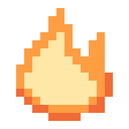

# Welcome to Kagero

<figure><figcaption></figcaption></figure>

**Kagero 陽炎** ("heat haze") is a small, fast desktop editor for pixel art and frame-by-frame animation by **Onibi Lab**. Draw on a pixel-exact canvas, animate with a timeline and onion skin, and export PNGs, GIFs and sprite sheets for your game — in one program that runs offline, with no account and no installer.


**Current version: 0.3.7 Beta** · Windows 10/11 x64 · [Download the latest release](https://github.com/senzukisu/kagero/releases/latest)


## Start here

<table data-view="cards"><thead><tr><th></th><th></th><th data-hidden data-card-cover data-type="files"></th><th data-hidden data-card-target data-type="content-ref"></th></tr></thead><tbody><tr><td><strong>Install &#x26; update</strong></td><td>Download, unzip, run — and keep Kagero up to date.</td><td><a href=".gitbook/assets/start-screen.png">start-screen.png</a></td><td><a href="getting-started/installation.md">installation.md</a></td></tr><tr><td><strong>Quick start</strong></td><td>Your first animation, from a blank canvas to a sprite sheet, in ten minutes.</td><td><a href=".gitbook/assets/timeline.png">timeline.png</a></td><td><a href="getting-started/first-animation.md">first-animation.md</a></td></tr><tr><td><strong>The workspace</strong></td><td>What every part of the window does.</td><td><a href=".gitbook/assets/workspace-map.png">workspace-map.png</a></td><td><a href="getting-started/interface-tour.md">interface-tour.md</a></td></tr></tbody></table>

## What you can do

<table data-view="cards"><thead><tr><th></th><th></th><th data-hidden data-card-cover data-type="files"></th><th data-hidden data-card-target data-type="content-ref"></th></tr></thead><tbody><tr><td><strong>Draw</strong></td><td>Pencil, fill, shapes, selection and transforms, palettes and layers.</td><td><a href=".gitbook/assets/selection.png">selection.png</a></td><td><a href="draw/drawing-tools.md">drawing-tools.md</a></td></tr><tr><td><strong>Animate</strong></td><td>Frames with their own timing, live thumbnails, real-time preview, onion skin.</td><td><a href=".gitbook/assets/preview.png">preview.png</a></td><td><a href="animate/animation.md">animation.md</a></td></tr><tr><td><strong>Export for games</strong></td><td>PNG, JPEG, WebP, animated GIF and sprite sheets with JSON metadata.</td><td><a href=".gitbook/assets/export-sheet.png">export-sheet.png</a></td><td><a href="export/export/">export</a></td></tr></tbody></table>

## Principles

* **Pixel-exact.** Every image pixel covers whole screen pixels, at any zoom and any Windows display scale.
* **Safe with your work.** Saving never leaves a half-written file, and every edit can be undone.
* **Works offline.** Updates and Discord are optional extras, never requirements.
* **Private by default.** Nothing about your projects leaves your computer unless you turn it on.


Kagero is open source under the MIT License: [github.com/senzukisu/kagero](https://github.com/senzukisu/kagero). Questions and bug reports go to the [issue tracker](https://github.com/senzukisu/kagero/issues).

