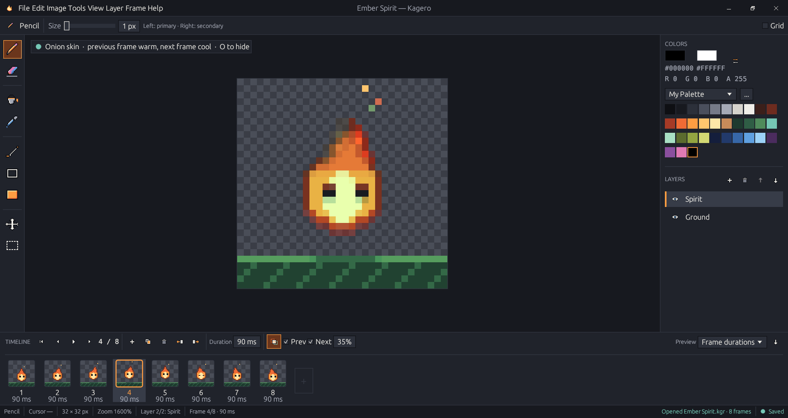

  

<h1 align="center">Kagero documentation</h1>

  <b>Kagero 0.4.3 Beta</b> · Windows 10/11 ·
  <a href="https://github.com/senzukisu/kagero/releases/latest">Download</a> ·
  <a href="about/changelog.md">What's new</a> ·
  <a href="about/roadmap.md">Roadmap</a>

**Kagero 陽炎** ("heat haze") is a small, fast desktop editor for pixel art and
frame-by-frame animation. Draw on a pixel-exact canvas, animate with a timeline and
onion skin, and export images, animations and sprite sheets for your game. It runs
offline and needs no account.

**New to Kagero?** [Install it](getting-started/installation.md), then follow the
[Quick start](getting-started/first-animation.md): a small animated sprite, from a blank
canvas to a GIF, in about ten minutes.

## Contents

### Getting started

| Page | What's inside |
|------|---------------|
| [Install & update](getting-started/installation.md) | The installer or the portable zip, updates, and checking a download. |
| [Quick start](getting-started/first-animation.md) | Draw a small animated sprite and export it as a GIF and a sprite sheet. |
| [The workspace](getting-started/interface-tour.md) | Where everything is in the Kagero window. |

### Draw

| Page | What's inside |
|------|---------------|
| [Tools & canvas](draw/drawing-tools.md) | The tools, brushes, symmetry, dithering, fill options and moving around the canvas. |
| [Selection & transforms](draw/selection.md) | Rectangle, lasso and magic-wand selections; add, subtract and invert; move, copy, flip and rotate. |
| [Colors & palettes](draw/palettes.md) | Primary and secondary colors, HEX/RGBA entry, palettes, palette files and Convert to Palette. |
| [Layers](draw/layers.md) | Opacity and locks, duplicate and merge, canvas size and crop. |

### Animate

| Page | What's inside |
|------|---------------|
| [Animation](animate/animation.md) | Frames, frame tags, the timeline, real-time preview and onion skin. |

### Files & export

| Page | What's inside |
|------|---------------|
| [Projects & import](export/files-and-export.md) | New images, `.kgr` projects, PNG import and safe saving. |
| [Export](export/export.md) | The Export dialog: PNG, JPEG and WebP images, frames and tags, scale and file names. |
| [Animations: GIF and WebP](export/animated-export.md) | Timing, looping, transparency and colors. |
| [Sprite sheets](export/sprite-sheets.md) | Grid and packed layouts, spacing, padding, trim, extrude and metadata for game engines. |

### Reference

| Page | What's inside |
|------|---------------|
| [Keyboard shortcuts](reference/keyboard-shortcuts.md) | Every shortcut in one place. |
| [Settings](reference/settings.md) | General and autosave, Shortcuts, Updates, Discord, Experimental, Plugins and Themes. |
| [Themes](reference/themes.md) | The built-in themes and how to make your own. |
| [Plugins](plugins/README.md) | Installing plugins, the ready-made ones, and writing your own in Lua. |
| [FAQ & troubleshooting](reference/faq.md) | Common questions and fixes. |

### For developers

| Page | What's inside |
|------|---------------|
| [Architecture](developers/architecture.md) | How the code is organized: layers, data model, undo history, export. |
| [The `.kgr` project format](developers/project-format.md) | File versions, migration, validation and compatibility tests. |
| [Sprite sheet metadata](developers/metadata-format.md) | The JSON written next to sprite sheets: Kagero JSON v1 and JSON Hash. |
| [Services](developers/services.md) | The updater, the install helper and Discord Rich Presence. |
| [UI design](developers/ui-design.md) | The Kagero Ember style: palette, pixel style, icons, fonts and layout. |
| [Contributing](developers/contributing.md) | Building, tests, benchmarks, rules and publishing a release. |

### About

| Page | What's inside |
|------|---------------|
| [Roadmap](about/roadmap.md) | The plan up to 1.0, what each version is for, and what's done. |
| [Changelog](about/changelog.md) | What changed in each version. |
| [How Kagero is made](about/ai-assistance.md) | An honest note on how Kagero is developed. |
| [License](about/license.md) | The MIT License and third-party components. |

## How Kagero works for you

* **Pixel-exact.** Every image pixel covers whole screen pixels, at any zoom and any
  Windows display scale.
* **Safe with your work.** Every edit can be undone, saving never leaves a half-written
  file, and autosave keeps a copy in case Kagero closes unexpectedly.
* **Offline and private.** Updates and Discord are optional. Nothing about your
  projects leaves your computer unless you turn it on.

Kagero is open source under the MIT License:
[github.com/senzukisu/kagero](https://github.com/senzukisu/kagero). Questions and bug
reports go to the [issue tracker](https://github.com/senzukisu/kagero/issues).
