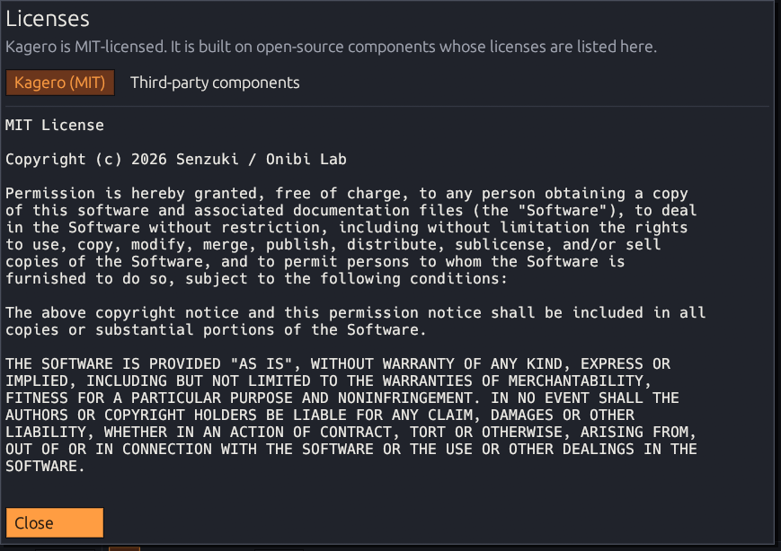

# License

Kagero's source code is released under the **MIT License** —
[full text](https://github.com/senzukisu/kagero/blob/main/LICENSE).

Copyright © 2026 Senzuki / Onibi Lab.

## Third-party components

Kagero is built on open-source Rust crates such as **egui/eframe**, **image**, **zip**,
**serde**, **ureq**, **minisign-verify** and **discord-rich-presence**, all under
permissive licenses (MIT, Apache-2.0, BSD, Zlib, ISC, BSL-1.0, Unicode). The complete
list with versions is in
[THIRD_PARTY_LICENSES.md](https://github.com/senzukisu/kagero/blob/main/THIRD_PARTY_LICENSES.md).
Both texts are also built into Kagero: **Help → Licenses…** (or **Licenses** in the
About window).

<figure><figcaption></figcaption></figure>

* egui bundles the Ubuntu-Light, Hack, Noto Emoji and emoji-icon fonts (Ubuntu Font
  Licence 1.0, MIT, SIL OFL 1.1).
* Kagero's icons, logo and the Kagero Pixel font are original work by Onibi Lab (MIT).
* Kagero is not affiliated with Aseprite, Igara Studio or Discord.
