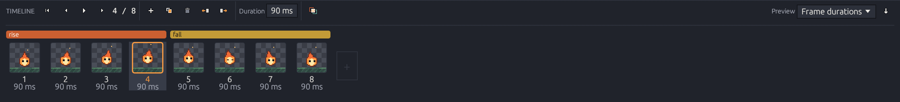
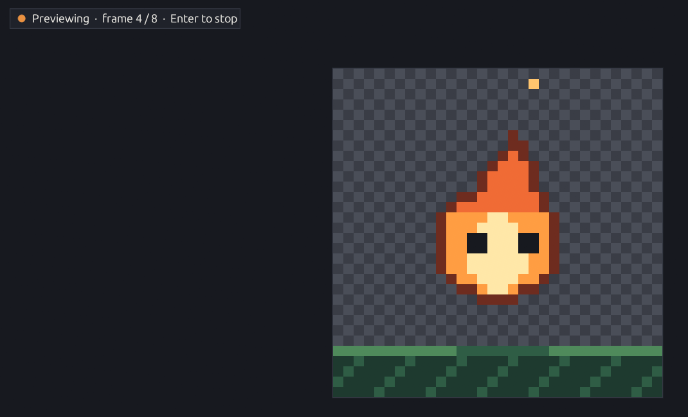

# Animation

Kagero animates frame by frame: you draw each frame, and every frame keeps its own
image on each layer and its own **duration**.

<figure><figcaption></figcaption></figure>

## Frames

| Action | Where | Shortcut |
|--------|-------|----------|
| New empty frame (after the current) | Timeline **+**, Frame menu | <kbd>Alt</kbd>+<kbd>N</kbd> |
| Duplicate frame | Timeline, Frame menu, right-click a card | <kbd>Alt</kbd>+<kbd>D</kbd> |
| Delete frame | Timeline, Frame menu, right-click a card | — |
| Move left / right | Timeline arrows, Frame menu | — |
| Go to a frame | Click its card | <kbd>,</kbd> <kbd>.</kbd> (or <kbd>←</kbd> <kbd>→</kbd> with no selection) |
| First frame | Timeline, Frame menu | <kbd>Ctrl</kbd>+<kbd>Home</kbd> |
| Duration | **Duration** field (10 ms – 60 s) | — |
| Pick frames for export | <kbd>Ctrl</kbd>+click toggles a card, <kbd>Shift</kbd>+click selects a range | — |

* Every frame operation can be undone. Undoing a change made on another frame jumps
  to that frame.
* Deleting a frame with drawings asks first; the last frame can't be deleted.
* Up to 1000 frames, within the memory budget.

## Frame tags

A **tag** names a range of frames, for example *walk*, *idle* or *attack*. Tags are
colored bars above the frame cards; overlapping tags get their own rows.

| Action | How |
|--------|-----|
| New tag | Right-click a frame → **New Tag…** (or **New Tag from Selection…** with several frames selected), Frame → New Tag…, or <kbd>Alt</kbd>+<kbd>T</kbd>. Give it a name, a range and a color. |
| Select its frames | Click the bar |
| Edit or delete | Double-click the bar, or right-click → **Edit Tag…** / **Delete Tag**. Deleting a tag keeps its frames. |
| Loop it in the preview | Right-click the bar → **Loop in Preview**. A **Loop: name ×** button next to the frame counter turns it off. |
| Jump between tags | <kbd>Alt</kbd>+<kbd>,</kbd> / <kbd>Alt</kbd>+<kbd>.</kbd> (also in the Frame menu) |

* A new frame inside a tag, or right after its last frame, joins the tag. For example,
  duplicating the last frame of *walk* makes *walk* one frame longer.
* Deleting a frame shrinks its tag. If it was the tag's only frame, the tag goes away,
  and one undo brings both back.
* Moving frames left or right keeps the tags' ranges: a tag marks a stretch of the
  timeline.
* Tags are saved in the project and can be exported on their own (**Frames → Tag** in
  the Export dialog). They are also written into sprite-sheet metadata.

## The timeline

Playback controls, frame actions, duration and onion skin sit on top; below is a strip
of **frame cards** — a live thumbnail, the frame number and its duration. The current
frame has an amber border.

* Drag the panel's top edge to resize it; <kbd>F7</kbd> collapses it.
* Right-click a card for Duplicate, Move and Delete.

## Preview

<kbd>Enter</kbd> (or the play button) loops the animation from the current frame;
<kbd>Enter</kbd> or <kbd>Esc</kbd> stops on the frame that was showing. With a tag set
to **Loop in Preview**, only that tag's frames play.

<figure><figcaption>
While the preview plays, a badge shows the frame; drawing is paused.
</figcaption></figure>



Each frame stays on screen for its own duration — give key poses more time.



Every frame lasts the same time (1–60 fps), ignoring stored durations — handy for
checking an animation at your game's frame rate.



Timing follows the real clock, so a busy computer never slows the animation down.

## Onion skin

<kbd>O</kbd> (or the onion button) shows the neighbor frames over the current one: the
**previous** frame in a **warm** tint and the **next** in a **cool** tint, at 5–90 %
opacity (default 35 %). The first and last frames show only one side.


Onion skin is purely visual: it never changes your pixels, is never saved and never
appears in exports. It hides while the preview plays.


To export the animation, see [Animations: GIF and WebP](../export/export/animated-export.md) and
[Sprite sheets](../export/export/sprite-sheets.md).
