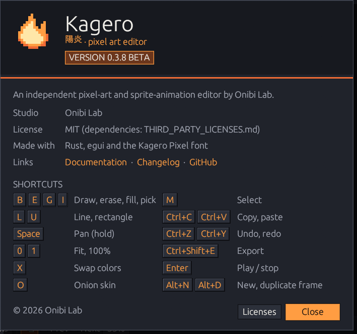
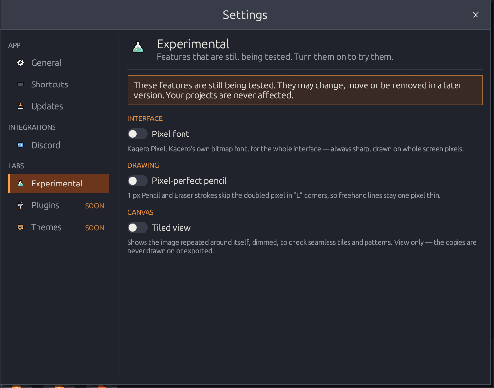
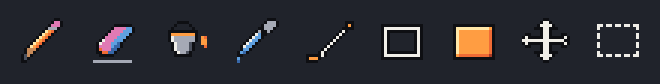

# UI design: Kagero Ember

**Mood:** a dark Japanese workshop at night, lit by warm amber — calm, precise,
functional, and drawn in pixels like the art made in it. Kagero (陽炎) means "heat
haze"; the flame mark is the shimmer above an ember.

<figure><figcaption>
The About window shows the style in one place: banner, ember rule, badge, keycaps.
</figcaption></figure>

## Palette

| Token | Hex | Use |
|-------|-----|-----|
| Background | `#17191F` | window, bars, canvas surroundings |
| Panel | `#20232B` | side panels, dialogs |
| Surface | `#2C303A` | buttons, inputs, hovered rows |
| Secondary text | `#A5A9B5` | labels, hints |
| Primary text | `#F0EEE8` | content text |
| Accent | `#FF9D42` | selection, primary buttons, focus |
| Accent pressed | `#F06B35` | pressed state, rules |
| Ember deep | `#6B361C` | pressed and selected items behind light text |
| Success · Error | `#75C7B5` · `#E85D5D` | "Saved", messages |
| Bevel light · dark | `#4A4F5C` · `#0E0F13` | window outlines, bevels, icon outlines |

Text on the accent uses `#1A1410`. All tokens live in `src/theme.rs`.

## Pixel style

* **Square corners** everywhere.
* **Hard shadows** with no blur: 4 px for windows, 3 px for menus, 6 px for the start
  card and About.
* **Bevels:** icon buttons are flat until hovered (raised: light top-left, dark
  bottom-right), pressed in while held or selected; the active tool has a 1 px amber
  outline. Text buttons sit in a 1 px dark outline that turns amber on hover.
* Rectangular slider handles and solid 8 px scrollbars.

## Title bar

Kagero draws its own 32 px window frame (`src/ui/title_bar.rs`): the flame, the menus,
the document title centered on the window, and 46 px minimize / maximize / close
buttons drawn as 10×10 pixel glyphs (close turns red on hover). See
[The workspace](../getting-started/interface-tour.md#the-title-bar).

## Settings window

A side menu of pages with 16 px icons, grouped under **App**, **Integrations** and
**Labs**; the open page has an ember fill and a 3 px amber bar, planned pages carry a
"SOON" tag. Each page starts with a 2× icon, its title and a one-line description;
section titles are small amber capitals.

<figure><figcaption></figcaption></figure>

## Icons

All icons are original 16×16 bitmaps in `src/ui/icons.rs`, colored from a small fixed
palette with dark outlines and two-tone shading — 2× in the toolbar, 1× in compact rows,
faded to gray when disabled. Each icon shows the thing itself: a paint bucket for Fill,
⇄ for Swap Colors, overlapping warm/current/cool frames for Onion Skin, a frame with an
arrow for Move Frame, a keyboard, download tray, chat bubble, flask, plug and palette
for the settings pages. They are drawn as one mesh of whole device pixels, so they
stay crisp at any display scale. The window icon is the 16×16 flame scaled ×4.

<figure><figcaption></figcaption></figure>

## Fonts

* **Classic** (default): egui's bundled fonts — body 14 pt, headings 20 pt, big titles
  34 pt (`theme::font(n)`).
* **Kagero Pixel** (Settings → General, experimental): Kagero's own bitmap font (MIT) —
  ASCII, Cyrillic and the interface symbols. Glyphs are drawn as `#`/`.` rows in
  `assets/fonts/kagero-pixel.txt`; `python scripts/build-font.py` (needs `fonttools`)
  builds `KageroPixel.ttf`, enlarging the compact 8×5 drawings by doubling rows and
  columns that hold no strokes, so lines stay one pixel thin. Sizes are snapped so one
  font pixel is a whole number of device pixels.
* On Windows a system Japanese font (Yu Gothic / MS Gothic / Meiryo) is loaded at
  runtime for "陽炎"; it is never redistributed.

## Layout rules

* **Toolbar:** 36 px icon buttons in groups; tooltips show name and shortcut.
* **Tool options:** only options that exist for the active tool, plus a one-line hint.
* **Canvas:** a checkerboard where one square is one image pixel; squares merge into
  2×2, 4×4… blocks only when a pixel is smaller than 3 device pixels. The pixel grid
  appears from 600 %. The image origin snaps to device pixels.
* **Timeline:** a controls row above 64 px frame cards; the current card has a 2 px
  amber border.
* **Dialogs:** centered, primary action as an accent button on the left; Escape or a
  click outside cancels. Dialogs never exceed the screen — long content scrolls.
* **Status bar:** facts on the left, messages and the save indicator on the right.
* **Onion tints:** previous frame warm (`#FF7A5C`), next frame cool (`#6FD6C2`).
