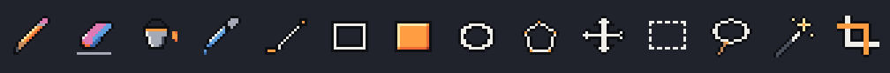

# Tools & canvas

<figure><figcaption></figcaption></figure>

| Tool | Key | What it does |
|------|-----|--------------|
| **Pencil** | <kbd>B</kbd> | Paints with the brush. Fast strokes are joined into continuous lines. |
| **Eraser** | <kbd>E</kbd> | Makes pixels fully transparent. |
| **Fill** | <kbd>G</kbd> | Fills an area of similar color (see [Fill](#fill)). |
| **Eyedropper** | <kbd>I</kbd> | Picks a color from the merged image or from the active layer only. |
| **Line** | <kbd>L</kbd> | Drag to draw a pixel-perfect line. |
| **Rectangle** | <kbd>U</kbd> | Drag to draw an outline. |
| **Filled Rectangle** | <kbd>Shift</kbd>+<kbd>U</kbd> | Drag to draw a solid rectangle. |
| **Ellipse** | <kbd>K</kbd> | Drag a box; the ellipse fills it exactly. **Filled** in the tool options. |
| **Polygon** | <kbd>P</kbd> | Click the corners. Double-click, <kbd>Enter</kbd> or clicking the last corner again closes it; <kbd>Esc</kbd> cancels. **Filled** in the tool options. |
| **Pan** | <kbd>H</kbd> | Drag to move the view. <kbd>Space</kbd>+drag works with any tool. |
| **Rectangle Select**, **Lasso**, **Magic Wand** | <kbd>M</kbd>, <kbd>Q</kbd>, <kbd>W</kbd> | Select pixels; see [Selection & transforms](selection.md). |
| **Crop** | <kbd>C</kbd> | Cut the canvas to a frame; see [Layers](layers.md#canvas-size-and-crop). |

* **Left** button = primary color, **right** button = secondary color.
* One stroke (from mouse down to mouse up) is **one undo step**. A polygon is one step
  too. Shapes preview while you drag, and <kbd>Esc</kbd> cancels them.
* Drawing outside the image is ignored; the stroke continues when you come back in.
* When the window is short, the tool strip uses two columns.


You can't draw on a **hidden** or **locked** layer, or while the animation preview
plays. The status bar tells you why instead of painting invisibly.


## Brush, symmetry and dithering

The tool options bar of Pencil, Eraser, Line, Rectangle, Ellipse and Polygon has:

* **Size**: 1 to 32 px. An amber outline on the canvas shows exactly which pixels will
  change.
* **Brush tip**:
  * **Square**.
  * **Circle**: 3 px is a plus, bigger sizes are discs.
  * **Custom**: select pixels, then **Edit → Use Selection as Brush**
    (<kbd>Ctrl</kbd>+<kbd>B</kbd>). The colored pixels of the selection become the
    brush's shape (up to 64×64) and paint in the current color. A custom brush lasts
    until Kagero closes.
* **Dither**: **Solid**, **25%**, **Checker 50%** or **75%** paints only part of the
  pixels in a fixed pattern. The pattern is tied to the image grid, so separate strokes
  line up seamlessly.
* **Mirror ↔ / Mirror ↕** (symmetry): everything you draw is also drawn mirrored
  around the image's center lines, which are shown on the canvas. Both together give
  four-way symmetry, and the whole stroke is still one undo step.

For cleaner 1 px freehand lines, turn on **Pixel-perfect pencil** in
[Settings → Experimental](../reference/settings.md#experimental-features).

## Fill

| Option | Meaning |
|--------|---------|
| **Tolerance** (0–255) | How much a color may differ from the clicked one and still be filled. 0 means exactly the same color. Fully transparent pixels always count as one color. |
| **Contiguous** | On: only the connected area. Off: every similar pixel of the layer. |
| **Source** | Decide the area from the **active layer** or from **all visible layers**. The paint always goes on the active layer. |

Fill stays **inside the selection** when there is one, and follows the **Dither**
pattern. Undo restores every pixel's own color.

## Moving around

| Action | How |
|--------|-----|
| Zoom at the cursor | Mouse wheel |
| Zoom in / out | <kbd>+</kbd> / <kbd>−</kbd> |
| Actual size · fit to window | <kbd>1</kbd> · <kbd>0</kbd> |
| Center the image | <kbd>Home</kbd> |
| Pan | <kbd>Space</kbd>+drag, middle-drag or the Pan tool |
| Pixel grid | <kbd>Ctrl</kbd>+<kbd>G</kbd> (visible from 600 % zoom) |

The transparency checkerboard is aligned to the image: one square is one pixel, at any
zoom and display scale.

## The Image menu

* **Flip Horizontal / Vertical** and **Rotate 90° / 180° / 270°** work on the
  selection, or on the whole active layer when nothing is selected.
* **Canvas Size…**, **Crop** and **Crop to Selection**: see
  [Layers](layers.md#canvas-size-and-crop).
* **Convert to Palette…**: see [Colors & palettes](palettes.md#convert-to-palette).
