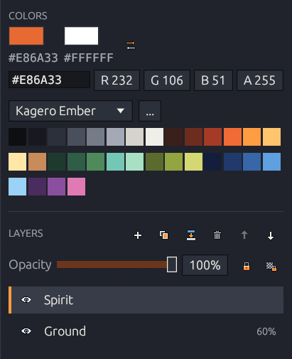

# Colors & palettes

<figure><figcaption></figcaption></figure>

## Primary and secondary

* The **left** mouse button paints with the primary color, the **right** with the
  secondary. <kbd>X</kbd> swaps them.
* Click a big swatch for the color picker (with alpha).
* Under each swatch is its **HEX** code. Click it to copy (`#RRGGBB`, or `#RRGGBBAA`
  for translucent colors).
* **Exact entry** for the primary color:
  * Type a HEX code (`#RGB`, `#RRGGBB` or `#RRGGBBAA`) and press <kbd>Enter</kbd>. An
    invalid code turns red and changes nothing.
  * Or drag or type the **R G B A** values (0–255).
* The **Recent** row keeps the last 12 colors you painted or filled with.

## Palettes

Pick a palette in the drop-down above the swatches.

* Click a swatch to use it.
* Right-click a swatch for **Use as Secondary**, **Copy HEX**, **Move Left / Right** and
  **Remove from Palette**.
* Switching palettes never changes your drawing.

| Built-in palette | Colors |
|------------------|--------|
| **Kagero Ember** | The default: neutrals, ember warms, moss greens and night blues |
| **Ember** | A fire ramp from soot to white-hot, with warm earth tones |
| **Night Sakura** | Deep night blues, cherry-blossom pinks and a moonlit teal |
| **Misty Forest** | Layered greens, fog greys and bark browns |

The **...** menu next to the picker has:

* **Add Primary Color** and **Convert Image to Palette…**;
* **New / Duplicate / Rename / Delete Palette**;
* **Import / Export Palette…**;
* **Restore Built-in Palettes** (your own palettes are kept).

Palettes are saved with your settings, not in projects: up to 64 palettes of up to 256
colors.

## Convert to Palette

**Image → Convert to Palette…** replaces every color with the **nearest color of the
current palette**.

* **Change:** the active layer in this frame, the active layer in all frames, or all
  unlocked layers in all frames.
* **Preview:** **Before** and **After** of the current frame, with how many colors each
  has.
* Transparency is kept (alpha isn't changed), and fully transparent pixels stay as they
  are.
* The whole conversion is **one undo step**.

## Palette files

| Format | Contents |
|--------|----------|
| **GIMP palette** (`.gpl`) | `GIMP Palette` header, optional `Name:`, then `R G B name` lines. No alpha. |
| **HEX** (`.hex`, `.txt`) | One `RRGGBB` per line; `AARRGGBB` lines keep alpha. `;` and `//` start comments. |

Files over 1 MiB or with more than 256 colors are refused with a clear message.
