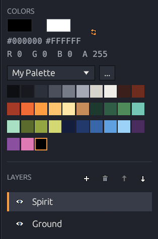

# Colors & palettes

<figure><figcaption></figcaption></figure>

## Primary and secondary

* The **left** mouse button paints with the primary color, the **right** with the secondary. <kbd>X</kbd> swaps them.
* Click a big swatch for the color picker (with alpha).
* Under each swatch is its **HEX** code — click to copy (`#RRGGBB`, or `#RRGGBBAA` for translucent colors). The line below shows the primary color as **R G B A**.
* The **Recent** row keeps the last 12 colors you painted or filled with.

## Palettes

Pick a palette in the drop-down above the swatches. Click a swatch to use it; right-click it for **Use as Secondary**, **Copy HEX**, **Move Left / Right** and **Remove from Palette**. Switching palettes never changes your drawing.

| Built-in palette | Colors                                                          |
| ---------------- | --------------------------------------------------------------- |
| **Kagero Ember** | The default: neutrals, ember warms, moss greens and night blues |
| **Ember**        | A fire ramp from soot to white-hot, with warm earth tones       |
| **Night Sakura** | Deep night blues, cherry-blossom pinks and a moonlit teal       |
| **Misty Forest** | Layered greens, fog greys and bark browns                       |

The **...** menu next to the picker: **Add Primary Color**, **New / Duplicate / Rename / Delete Palette**, **Import / Export Palette…** and **Restore Built-in Palettes** (your own palettes are kept).

Palettes are saved with your settings, not in projects: up to 64 palettes of up to 256 colors.

## Palette files

| Format                    | Contents                                                                         |
| ------------------------- | -------------------------------------------------------------------------------- |
| **GIMP palette** (`.gpl`) | `GIMP Palette` header, optional `Name:`, then `R G B name` lines. No alpha.      |
| **HEX** (`.hex`, `.txt`)  | One `RRGGBB` per line; `AARRGGBB` lines keep alpha. `;` and `//` start comments. |

Files over 1 MiB or with more than 256 colors are refused with a clear message.
