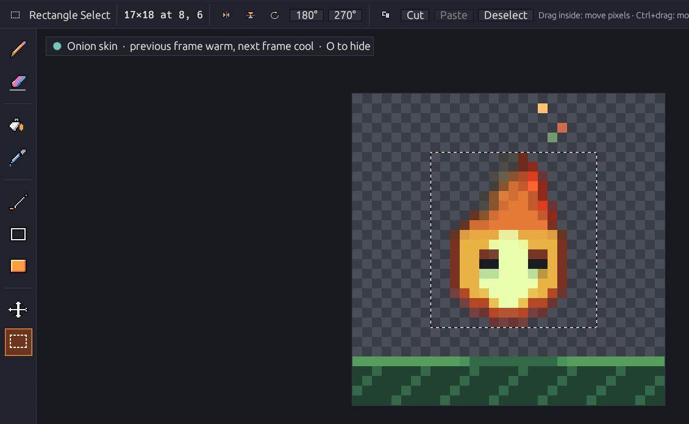

# Selection & transforms

Press <kbd>M</kbd> (or pick **Rectangle Select**) to work with a part of the active layer. Drag on the canvas; marching ants show the selection, and the tool options bar shows its size and position with buttons for every action.

<figure><figcaption>
A 17×18 selection; flip, rotate, cut, copy, paste and deselect are in the tool options bar.
</figcaption></figure>

## Select

| Action                | How                                            |
| --------------------- | ---------------------------------------------- |
| New selection         | Drag on the canvas                             |
| Select all            | <kbd>Ctrl</kbd>+<kbd>A</kbd>                   |
| Deselect              | <kbd>Esc</kbd>, or click outside the selection |
| Move only the outline | <kbd>Ctrl</kbd>+drag inside the selection      |

## Work with the selected pixels

| Action     | How                                                                                                                                  |
| ---------- | ------------------------------------------------------------------------------------------------------------------------------------ |
| Move       | Drag inside the selection, or arrow keys (<kbd>Shift</kbd>: 10 px)                                                                   |
| Copy · cut | <kbd>Ctrl</kbd>+<kbd>C</kbd> · <kbd>Ctrl</kbd>+<kbd>X</kbd>                                                                          |
| Paste      | <kbd>Ctrl</kbd>+<kbd>V</kbd> — at the original place, kept inside the image; the pasted pixels become the selection                  |
| Clear      | <kbd>Delete</kbd> makes the pixels transparent                                                                                       |
| Duplicate  | <kbd>Ctrl</kbd>+<kbd>D</kbd> places a copy next to the selection                                                                     |
| Flip       | <kbd>Shift</kbd>+<kbd>H</kbd> horizontal · <kbd>Shift</kbd>+<kbd>V</kbd> vertical                                                    |
| Rotate     | <kbd>Ctrl</kbd>+<kbd>R</kbd> 90° clockwise · <kbd>Ctrl</kbd>+<kbd>Shift</kbd>+<kbd>R</kbd> counterclockwise · 180° in the Image menu |

* Transparent pixels in a moved or pasted block don't erase what's below them.
* Rotating a non-square selection keeps its center; parts outside the image are cut off.
* Only the active layer of the current frame changes.
* Every operation is **one undo step**, and undo restores the selection outline too.


The selection is never saved in the project. The clipboard lives inside Kagero — it keeps transparency and survives opening another document.

