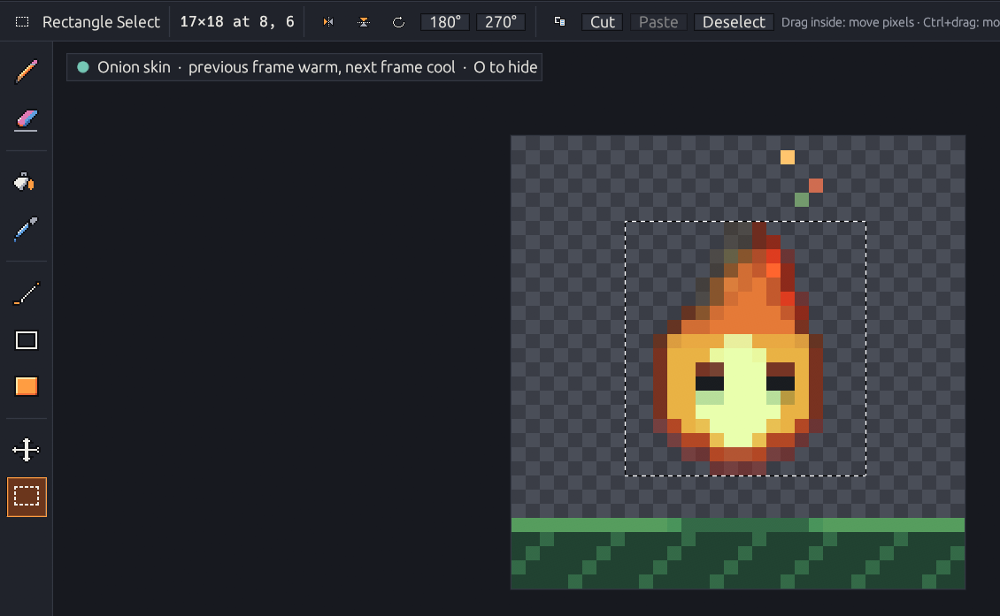

# Selection & transforms

A selection is any set of pixels on the active layer. Marching ants follow its exact
outline. The tool options bar shows its size and has buttons for every action.

<figure><figcaption>
Flip, rotate, cut, copy, paste and deselect are in the tool options bar.
</figcaption></figure>

## Selection tools

| Tool | Key | How |
|------|-----|-----|
| **Rectangle Select** | <kbd>M</kbd> | Drag a rectangle. |
| **Lasso** | <kbd>Q</kbd> | Drag around the pixels you want. The shape closes by itself, and the pixels under the line count too. |
| **Magic Wand** | <kbd>W</kbd> | Click a color to select it. |

Magic Wand options:

* **Tolerance** (0–255): how different a color may be and still be selected.
* **Contiguous**: off selects every similar pixel of the image.
* **Source**: compare colors on the **active layer** or on **all visible layers**.

## Combine selections

| Mode | Hold | Result |
|------|------|--------|
| **Replace** | | The new selection replaces the old one |
| **Add** | <kbd>Shift</kbd> | Adds to the selection |
| **Subtract** | <kbd>Alt</kbd> | Cuts out of the selection |
| **Intersect** | <kbd>Shift</kbd>+<kbd>Alt</kbd> | Keeps only the overlap |

You can also pick the mode with the buttons in the tool options bar. Holding the keys
overrides the button.

| Action | How |
|--------|-----|
| Select all | <kbd>Ctrl</kbd>+<kbd>A</kbd> |
| Invert selection | <kbd>Ctrl</kbd>+<kbd>Shift</kbd>+<kbd>I</kbd> |
| Deselect | <kbd>Esc</kbd> |
| Move only the outline | <kbd>Ctrl</kbd>+drag inside the selection (Rectangle Select) |

## Work with the selected pixels

| Action | How |
|--------|-----|
| Move | Drag inside the selection with Rectangle Select, or use the arrow keys (<kbd>Shift</kbd>: 10 px) |
| Copy · cut | <kbd>Ctrl</kbd>+<kbd>C</kbd> · <kbd>Ctrl</kbd>+<kbd>X</kbd> |
| Paste | <kbd>Ctrl</kbd>+<kbd>V</kbd>: at the original place, kept inside the image. The pasted pixels become the selection, with their shape. |
| Clear | <kbd>Delete</kbd> makes the selected pixels transparent |
| Duplicate | <kbd>Ctrl</kbd>+<kbd>D</kbd> places a copy next to the selection |
| Flip | <kbd>Shift</kbd>+<kbd>H</kbd> horizontal · <kbd>Shift</kbd>+<kbd>V</kbd> vertical |
| Rotate | <kbd>Ctrl</kbd>+<kbd>R</kbd> 90° clockwise · <kbd>Ctrl</kbd>+<kbd>Shift</kbd>+<kbd>R</kbd> counterclockwise · 180° in the Image menu |
| Use as brush | <kbd>Ctrl</kbd>+<kbd>B</kbd> (see [Tools & canvas](drawing-tools.md#brush-symmetry-and-dithering)) |

* Every action works on the **exact shape**. Pixels inside the selection's bounding box
  that aren't selected are never moved, copied or cleared.
* Transparent pixels in a moved or pasted block don't erase what's below them.
* Rotating keeps the selection's center; parts outside the image are cut off.
* Only the active layer of the current frame changes.
* Every action is **one undo step**, and undo restores the selection too.
* Fill stays inside the selection. Pencil and the shape tools don't (yet).


The selection is never saved in the project. The clipboard lives inside Kagero: it
keeps transparency and the selection's shape, and survives opening another document.

