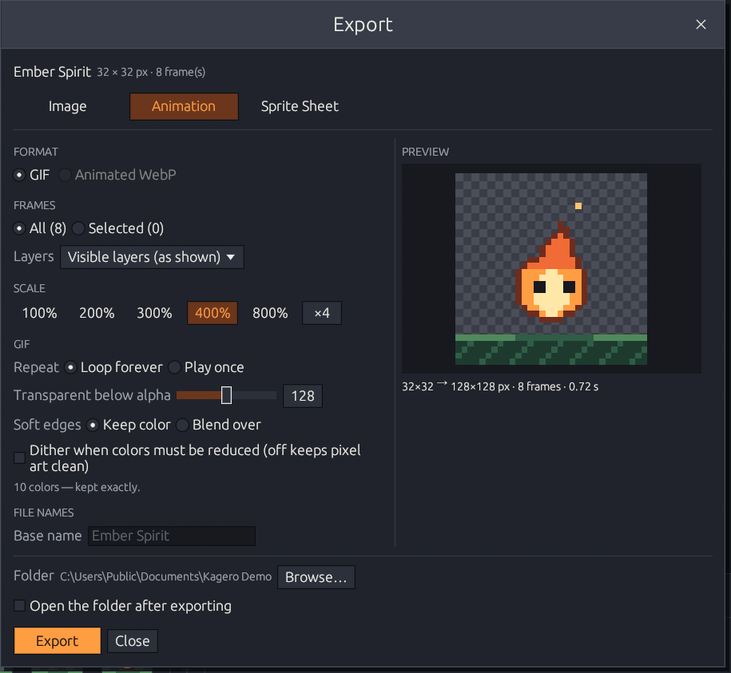

# Animations: GIF and WebP

The **Animation** tab of the Export dialog (**File → Export Animation as GIF…**) writes
`name.gif` or `name.webp`. Choose the format, the frames (all, selected, or a
[tag](../../animate/animation.md#frame-tags)), a [scale](README.md#frames-layers-scale)
and a folder. The preview plays with the real frame durations.

| Format | Colors and transparency | Timing | Plays in |
|--------|-------------------------|--------|----------|
| **GIF** | Up to 255 colors; pixels are fully transparent or fully opaque | 10 ms steps | Everything |
| **Animated WebP** | Every color and soft transparency, lossless | Exact milliseconds | Browsers and most engines; some older image viewers show only the first frame |

## Animated WebP

Lossless: what you see in Kagero is exactly what is stored, including semi-transparent
pixels. **Repeat** is *Loop forever* or *Play once*, and there is nothing else to set.
Each frame replaces the previous one completely.

## GIF

<figure><figcaption></figcaption></figure>

### Timing

Each frame keeps its duration from the timeline. GIF stores delays in 10 ms steps, so
Kagero rounds to the nearest step, with a minimum of **20 ms** (many viewers play
shorter delays far too slowly). The dialog warns when rounding changes your timing.

### Options

| Option | Choices |
|--------|---------|
| **Repeat** | *Loop forever* (default) or *Play once* (stops on the last frame) |
| **Transparent below alpha** | 1–255 (default 128): pixels with less alpha become transparent, the rest opaque |
| **Soft edges** | *Keep color*, or *Blend over* a color you pick — useful when you know the background |
| **Dither** | Off by default; mixes nearby colors to hide banding when colors must be reduced |

### Colors and transparency

* GIF pixels are either fully transparent or fully opaque; the dialog warns when the
  image has semi-transparent pixels.
* A GIF holds 256 colors and Kagero keeps one for transparency. With **255 colors or
  fewer** (almost all pixel art) every color is kept exactly; with more, they are
  reduced, and the dialog says so beforehand.
* Each frame fully replaces the previous one, so transparent areas never show leftovers.


For game engines, a [sprite sheet](sprite-sheets.md) with metadata is usually the best
choice.

