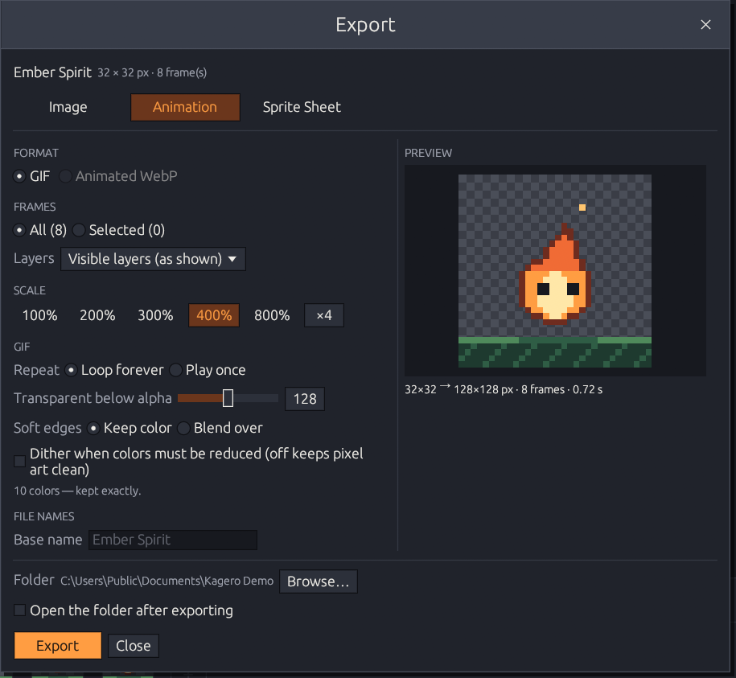

# Animated GIF

The **Animation** tab of the Export dialog (**File → Export Animation as GIF…**) writes `name.gif`. Choose the frames, a [scale](./#frames-layers-scale) and a folder; the preview plays with the real frame durations.

<figure><figcaption></figcaption></figure>

## Timing

Each frame keeps its duration from the timeline. GIF stores delays in 10 ms steps, so Kagero rounds to the nearest step, with a minimum of **20 ms** (many viewers play shorter delays far too slowly). The dialog warns when rounding changes your timing.

## Options

| Option                      | Choices                                                                              |
| --------------------------- | ------------------------------------------------------------------------------------ |
| **Repeat**                  | _Loop forever_ (default) or _Play once_ (stops on the last frame)                    |
| **Transparent below alpha** | 1–255 (default 128): pixels with less alpha become transparent, the rest opaque      |
| **Soft edges**              | _Keep color_, or _Blend over_ a color you pick — useful when you know the background |
| **Dither**                  | Off by default; mixes nearby colors to hide banding when colors must be reduced      |

## Colors and transparency

* GIF pixels are either fully transparent or fully opaque; the dialog warns when the image has semi-transparent pixels.
* A GIF holds 256 colors and Kagero keeps one for transparency. With **255 colors or fewer** (almost all pixel art) every color is kept exactly; with more, they are reduced, and the dialog says so beforehand.
* Each frame fully replaces the previous one, so transparent areas never show leftovers.


Animated WebP isn't available in this version. Use GIF for sharing, or a [sprite sheet](sprite-sheets.md) for game engines.

