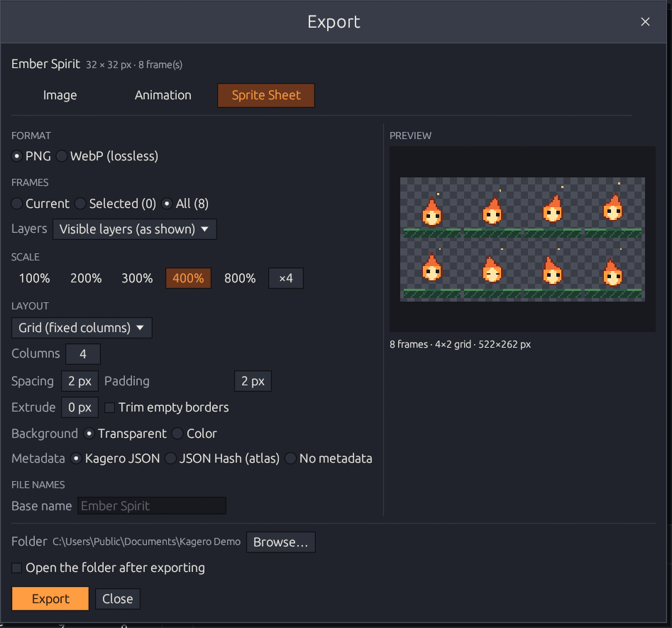

# Sprite sheets

The **Sprite Sheet** tab (**File → Export Sprite Sheet…**) puts the frames on one image
and can write a JSON file that says where each frame is. The preview shows the real
sheet and its size before you export.

<figure><figcaption>
Eight frames as a 4×2 grid at 400 % — 522×262 px.
</figcaption></figure>

## Layout

| Layout | Arrangement |
|--------|-------------|
| **Horizontal strip** | All frames in one row |
| **Vertical strip** | All frames in one column |
| **Grid (fixed columns)** | You set the columns; rows follow |
| **Grid (fixed rows)** | You set the rows; columns follow |

Frames go left to right, top to bottom, in timeline order. Every frame gets a cell of
the **same size**, so animations don't jump in engines.

| Option | Range | Meaning |
|--------|-------|---------|
| **Spacing** | 0–256 px | Gap between cells |
| **Padding** | 0–256 px | Empty border around the sheet |
| **Extrude** | 0–16 px | Repeats each frame's edge pixels outward, so engines that filter textures don't bleed neighbors in |
| **Trim empty borders** | on/off | Cuts each frame's transparent border; the metadata records the offsets |
| **Background** | Transparent / color | A color also fills spacing and padding |

All sizes are in output pixels (after scaling). The sheet is saved as **PNG** or
**lossless WebP**; sheets over 16 384 px per side or 512 MiB are refused before
anything is allocated.

## Metadata

| Option | For |
|--------|-----|
| **Kagero JSON** | Kagero's versioned format: order, durations, layout |
| **JSON Hash (atlas)** | The common texture-atlas layout read by Phaser, PixiJS and many other engines and tools |
| **No metadata** | Just the image |

The JSON file is saved next to the image with the same name. Frame names follow the
[file-name rules](README.md#file-names): `name_0001`, `name_0002`, … Both formats are
described field by field in [Sprite sheet metadata](../../developers/metadata-format.md).


Packed (bin-packing) layouts aren't available yet; every frame uses an equal cell.

