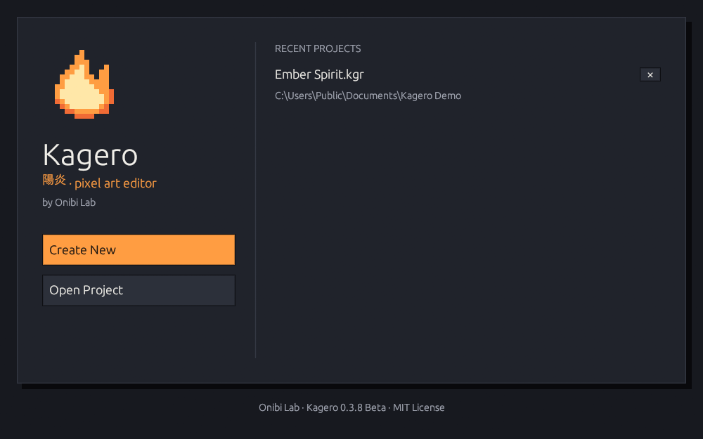

# Install & update

## Requirements

* Windows 10 or 11, 64-bit
* A graphics driver with OpenGL 2.0 or newer (any GPU from the last decade)
* About 10 MB of disk space

No installer, runtime or account is needed.

## Install



### Download

Open the [latest release](https://github.com/senzukisu/kagero/releases/latest) and
download `kagero-<version>-windows-x64.zip`.



### Unpack to a folder you own

Extract the zip, for example to `%LOCALAPPDATA%\Programs\Kagero`. It contains just
`kagero.exe`, `kagero-updater.exe` (used for updates) and `SHA256SUMS.txt` with the
checksums of both. The license texts are inside the program: **Help → Licenses…**.


Avoid `C:\Program Files`: Kagero updates itself in place, which needs a folder your
user account can write to.




### Run

Start `kagero.exe` and pin it to the taskbar if you like. Kagero opens maximized on the
start screen.

Windows SmartScreen may say the app is unrecognized, because the executable isn't
signed with a paid certificate. Choose **More info → Run anyway**. The package itself
is signed — see [Verify the download](#verify-the-download).



<figure><figcaption><p>The start screen: create an image, open a project, or pick a recent one.</p></figcaption></figure>

## Update

Kagero updates itself from the official
[GitHub Releases](https://github.com/senzukisu/kagero/releases).

* **Help → Check for Updates…** or **Settings → Updates → Check for Updates**.
* By default Kagero also checks at startup and once a day while it runs (6, 12, 24 or
  72 hours, or off).
* **Download Update** shows progress and can be canceled. Kagero then checks the size,
  the SHA-256 checksum and the package's **digital signature**; a package that fails
  any check is deleted and never installed.
* **Install and Restart** asks you to save unsaved work, closes Kagero, replaces its
  files (keeping a backup of the previous version) and starts it again — usually within
  a few seconds.

<figure><figcaption><p>Settings → Updates.</p></figcaption></figure>


**Install and Restart** needs an official build in a folder you can write to. Builds
made from source, or copies in `C:\Program Files`, can still check and download —
install those updates by hand from the release page.


### If an update goes wrong

* A failed installation **rolls back automatically** to the previous version.
* **Settings → Updates → Restore Previous Version** brings back the version you had
  before the last update.
* Details are logged in `<install folder>\.kagero-backup\update.log`.

| Message | Meaning |
|---------|---------|
| *couldn't reach GitHub* | No internet, a proxy or a firewall. Kagero keeps working; try later. |
| *request limit was reached* | GitHub allows about 60 checks per hour per network. Wait an hour. |
| *signature is missing or invalid* | Not an official package — it won't be installed. |

## Verify the download

Each release has `SHA256SUMS.txt` and a minisign signature (`.minisig`).



```powershell
Get-FileHash .\kagero-0.3.7-windows-x64.zip -Algorithm SHA256
```

Compare the result with the line in `SHA256SUMS.txt`.



```powershell
rsign verify kagero-0.3.7-windows-x64.zip -P RWSXS+R3BCdmSx47V91P3O9sUYv3G3tdbivI9Dta7p0hSgnJqkRV8wDe
```

The public key is also in [`kagero.pub`](https://github.com/senzukisu/kagero/blob/main/kagero.pub).



## Where Kagero keeps its files

| What | Where |
|------|-------|
| Settings | `%APPDATA%\OnibiLab\Kagero\config.json` |
| Log file | `%APPDATA%\OnibiLab\Kagero\kagero.log` |
| Previous version after an update | `<install folder>\.kagero-backup\` |

**Uninstall:** delete the Kagero folder, and `%APPDATA%\OnibiLab\Kagero` to remove the
settings too. Your `.kgr` projects stay wherever you saved them.

To build Kagero yourself, see [Contributing](../developers/contributing.md).
