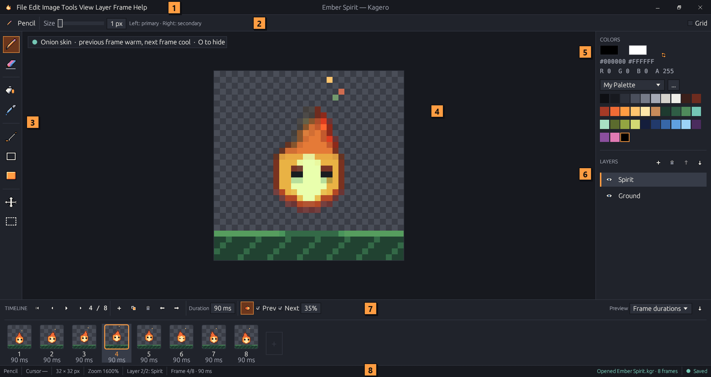
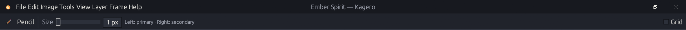

# The workspace

<figure><figcaption></figcaption></figure>

| # | Area                  | What it does                                                                                                                                                      |
| - | --------------------- | ----------------------------------------------------------------------------------------------------------------------------------------------------------------- |
| 1 | **Title bar & menus** | The flame, the File · Edit · Image · Tools · View · Layer · Frame · Help menus, the document title and the window buttons. Every menu command lists its shortcut. |
| 2 | **Tool options**      | Settings of the active tool — brush size, eyedropper source, selection actions — and the grid toggle.                                                             |
| 3 | **Toolbar**           | The tools. Hover a button for its name and shortcut. See [Tools & canvas](../draw/drawing-tools.md).                                                              |
| 4 | **Canvas**            | Your image. Wheel to zoom, <kbd>Space</kbd>+drag or middle-drag to pan, <kbd>Home</kbd> to center.                                                                |
| 5 | **Colors**            | Primary and secondary colors, HEX and RGBA, recent colors and the palette. See [Colors & palettes](../draw/palettes.md).                                          |
| 6 | **Layers**            | The layer stack: visibility, rename, reorder, add, delete. See [Layers](../draw/layers.md).                                                                       |
| 7 | **Timeline**          | Playback, frame actions, duration, onion skin and the frame cards. See [Animation](../animate/animation.md).                                                      |
| 8 | **Status bar**        | Tool, cursor position, image size, zoom, layer, frame, messages and the save state.                                                                               |

## The title bar

Kagero draws its own window frame.

* **Drag** an empty part of the bar to move the window; **double-click** it to maximize or restore.
* The buttons on the right minimize, maximize/restore and close. Close asks about unsaved changes first.
* A restored window can be resized from any edge or corner. Kagero opens maximized and remembers if you prefer a window.

<figure><figcaption></figcaption></figure>

## Panels

* <kbd>F7</kbd> collapses or expands the **timeline**; drag its top edge to resize it.
* <kbd>F8</kbd> hides or shows the **colors & layers** panel for more canvas space.
* The layout is remembered between launches.

## Canvas badges

Small badges in the top-left corner of the canvas explain special states: a pulsing amber dot while the animation preview plays, a teal dot while onion skin is on.

## The start screen

With no document open, Kagero shows **Create New**, **Open Project** and your recent projects. Missing files are dimmed and can be removed from the list with **×**.
