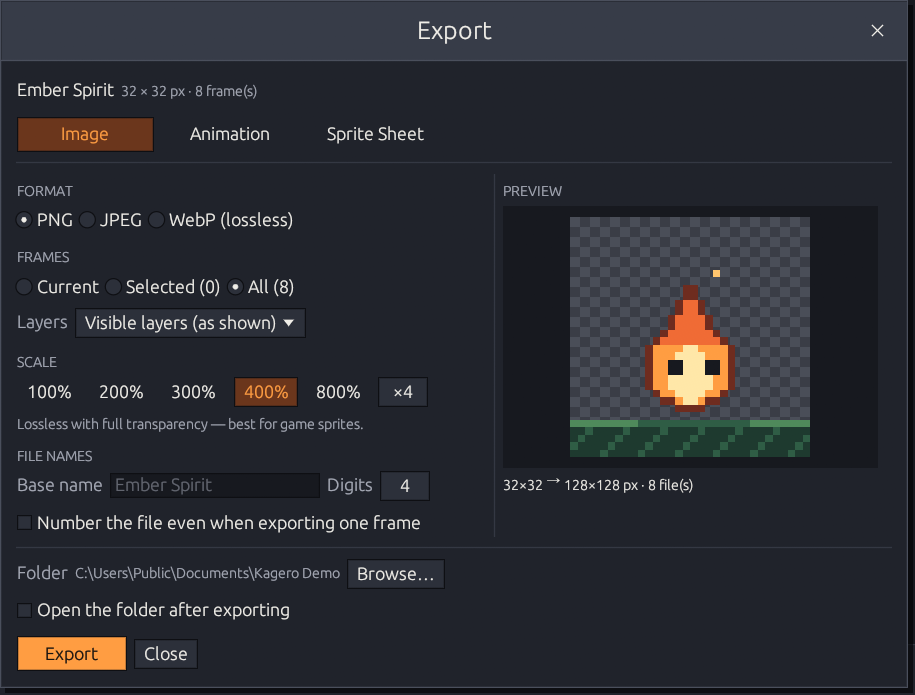

# Export

Everything leaves Kagero through one **Export** dialog —
<kbd>Ctrl</kbd>+<kbd>Shift</kbd>+<kbd>E</kbd> or **File → Export…**.
(<kbd>Ctrl</kbd>+<kbd>E</kbd> still saves the current frame as a PNG in one step.)

| Tab | Produces | Details |
|-----|----------|---------|
| **Image** | One file per frame: PNG, JPEG or WebP | this page |
| **Animation** | An animated GIF | [Animated GIF](animated-export.md) |
| **Sprite Sheet** | One image with all frames, plus optional JSON | [Sprite sheets](sprite-sheets.md) |

<figure><figcaption>
The Image tab. Every tab has a live preview and shows the output size.
</figcaption></figure>

The dialog remembers its settings per tab and per format. Exporting never changes your
project: Kagero copies the frames first and encodes in the background, so you can keep
drawing — or press **Cancel Export**.

## Frames, layers, scale

* **Frames:** *Current*, *Selected* (<kbd>Ctrl</kbd>/<kbd>Shift</kbd>+click cards in the
  timeline) or *All*.
* **Layers:** *Visible layers (as shown)* or *Active layer only*. Hidden layers and the
  onion skin are never exported.
* **Scale:** 100 / 200 / 300 / 400 / 800 % or any whole number up to ×64, always as
  sharp square pixels (nearest neighbor). Outputs larger than 16 384 px per side or
  512 MiB are refused before anything is written.

## Formats

| Format | Transparency | Compression | Use it for |
|--------|--------------|-------------|------------|
| **PNG** | Full alpha | Lossless | Game sprites, anything you'll edit again — **recommended** |
| **JPEG** | None — filled with a background color | Lossy | Previews and sharing |
| **WebP** | Full alpha | Lossless | The web; usually smaller than PNG |



Pixel-exact: every color and alpha value is written as is.



**Quality** 1–100 (default 90) and a **background** — white, black or any color — for
transparent and semi-transparent pixels.


JPEG uses lossy compression and may introduce artifacts into pixel art. PNG is
recommended for lossless game sprites.




Lossless with transparency. Lossy WebP and animated WebP are not available in this
version — the dialog shows them as unavailable. Use GIF for animations.



## File names

* **Base name** defaults to the project name; characters Windows doesn't allow are
  replaced.
* Several frames are numbered: `sprite_0001.png`, `sprite_0002.png`, … (**Digits**
  1–8). A single frame is saved without a number unless you ask for one.
* If any file already exists, Kagero asks once: **Replace** or **Cancel**. Files are
  written to a temporary name first, so a failed export never leaves half a file.
* When it's done, **Open Folder** shows the files (or tick *Open the folder after
  exporting*).
