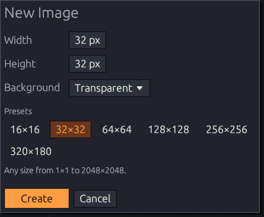

# Projects & import

## New image

<kbd>Ctrl</kbd>+<kbd>N</kbd> (or **Create New** on the start screen) asks for the size —
any size from 1×1 to 2048×2048, or a preset — and the background: transparent, white
or black.

<figure><figcaption></figcaption></figure>

## Projects (`.kgr`)

A `.kgr` project keeps **everything**: frames and durations, layers with their order,
names and visibility, and every pixel including transparency.

| Action | Shortcut |
|--------|----------|
| New | <kbd>Ctrl</kbd>+<kbd>N</kbd> |
| Open (`.kgr` or `.png`) | <kbd>Ctrl</kbd>+<kbd>O</kbd> |
| Save · Save As | <kbd>Ctrl</kbd>+<kbd>S</kbd> · <kbd>Ctrl</kbd>+<kbd>Shift</kbd>+<kbd>S</kbd> |
| Close document | <kbd>Ctrl</kbd>+<kbd>W</kbd> |

You can also open a file by passing it to `kagero.exe` — for example with
*Open with → Kagero* in Explorer.


**Saving is safe.** Kagero writes to a temporary file and only then replaces the old
project, so a crash or a full disk never leaves a half-written file.


* The title shows **•** and the status bar **Unsaved changes** when there is something
  to save; undoing back to the saved state clears it.
* Closing, opening another file or creating a new one with unsaved changes asks
  **Save / Don't Save / Cancel**.
* Projects from every earlier Kagero version open as they are.

## Importing PNG

<kbd>Ctrl</kbd>+<kbd>O</kbd> a PNG (up to 2048×2048) to edit it as a one-layer image.
<kbd>Ctrl</kbd>+<kbd>S</kbd> then asks where to save the `.kgr` project — the original
PNG is never overwritten.

## Limits

| Limit | Value |
|-------|-------|
| Image size | 1×1 to 2048×2048 |
| Layers · frames | 64 · 1000 |
| Memory budget | 512 MiB of pixel data |

Damaged or unsupported files show a clear error and never crash Kagero. The file layout
is described in [The .kgr project format](../developers/project-format.md).

To get images out of Kagero, see [Export](export.md).
