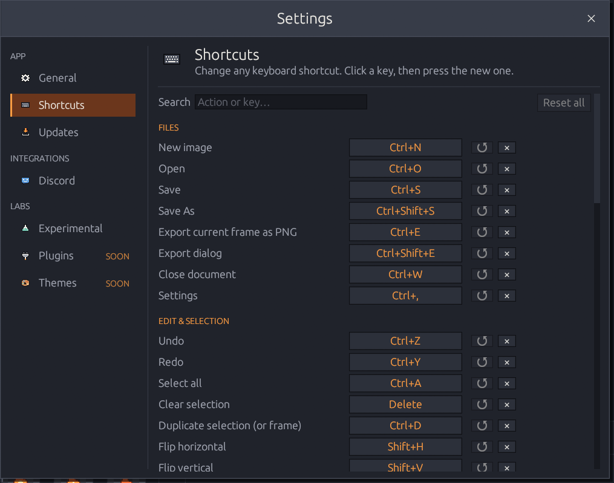
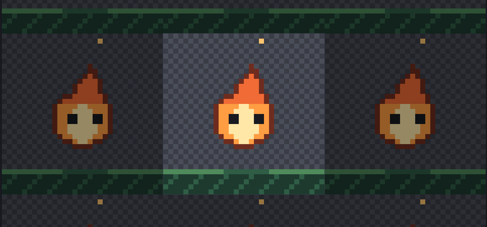
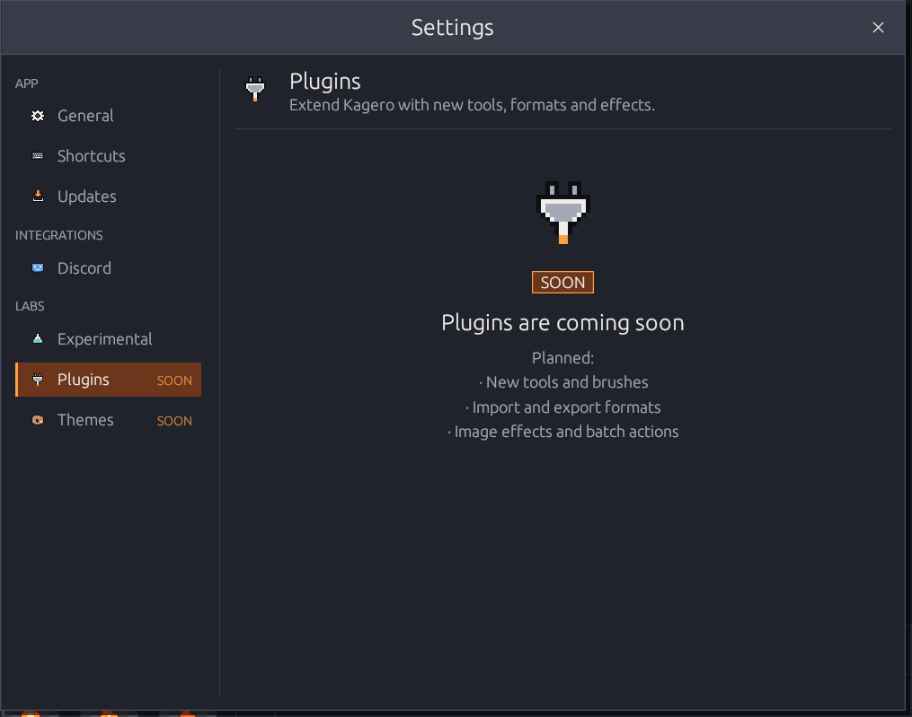
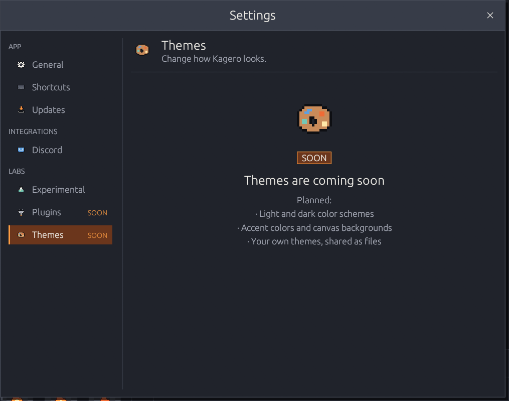

# Settings

**File → Settings…** or <kbd>Ctrl</kbd>+<kbd>,</kbd>. Pages are grouped in the side menu
— **App** (General, Shortcuts, Updates), **Integrations** (Discord) and **Labs**
(Experimental, Plugins, Themes). Changes apply immediately and are saved automatically.



<figure><figcaption></figcaption></figure>

* Show the timeline (<kbd>F7</kbd>) and the colors & layers panel (<kbd>F8</kbd>)
* Pixel grid when zoomed in (<kbd>Ctrl</kbd>+<kbd>G</kbd>)
* **Reduce motion** — turns off the pulsing preview badge and eased transitions
* **Onion skin** — show neighbor frames (<kbd>O</kbd>), previous (warm) and/or next
  (cool), opacity 5–90 %



<figure><figcaption></figcaption></figure>

See [Changing shortcuts](#changing-shortcuts) below.



<figure><figcaption></figcaption></figure>

* Current version and build type, **Check for Updates**, download with progress,
  **Install and Restart**
* Check at startup and periodically (6/12/24/72 hours)
* Include prereleases (betas), notify me when an update is found
* **Restore Previous Version** after an update

How updating works: [Install & update](../getting-started/installation.md#update).



<figure><figcaption></figcaption></figure>

See [Discord Rich Presence](#discord-rich-presence) below.



<figure><figcaption></figcaption></figure>

See [Experimental features](#experimental-features) below.



## Changing shortcuts

Every shortcut can be changed in **Settings → Shortcuts**.

1. Click the key next to an action — it shows **Press keys…**.
2. Press the new combination, e.g. <kbd>Ctrl</kbd>+<kbd>Alt</kbd>+<kbd>P</kbd>.
   <kbd>Esc</kbd> cancels.

* If the key already belongs to another action, it moves to the new one and the page
  says which action lost it.
* **↺** restores one default, **×** removes a key, **Reset all** restores every default.
* **Search** filters by action name or key.
* Menus and tooltips always show your current keys.

Some keys can't be changed: <kbd>Ctrl</kbd>+<kbd>C</kbd>/<kbd>X</kbd>/<kbd>V</kbd>
(Windows sends them as clipboard actions), <kbd>Esc</kbd>, <kbd>Space</kbd> (hold to
pan) and the arrow keys (nudge the selection or change frames). They're listed under
*Fixed keys*. Your changes are saved in the settings file; only the differences from
the defaults are stored.

## Experimental features

These features are switched on only in **Settings → Experimental**. They're still being
tested and may change in a later version; your projects are never affected.

| Feature | What it does |
|---------|--------------|
| **Pixel font** | Kagero Pixel, Kagero's own bitmap font, for the whole interface — always drawn on whole screen pixels. |
| **Pixel-perfect pencil** | 1 px Pencil and Eraser strokes skip the doubled pixel in "L" corners, so freehand lines stay one pixel thin. |
| **Tiled view** | Shows the image repeated around itself, dimmed, to check seamless tiles and patterns. View only — the copies are never drawn on or exported. |

<figure><figcaption>
Tiled view: the image in the middle, dimmed copies around it.
</figcaption></figure>

## Plugins and themes

**Plugins** (new tools, formats and effects) and **Themes** (color schemes, accents,
your own themes) are planned — their pages show what's coming.



<figure><figcaption></figcaption></figure>



<figure><figcaption></figcaption></figure>



## Discord Rich Presence

When the **Discord desktop app** runs on the same computer, Kagero can show what you're
doing in your Discord profile — no login, token or password.

| You are… | Discord shows |
|----------|---------------|
| On the start screen | *Browsing the Workshop* · *Ready to Create* |
| Editing a single image | *Creating Pixel Art* · *Editing a Sprite* |
| Editing an animation | *Animating Sprites* · *Animating* |
| Watching the preview | *Previewing Animation* · *Animating* |
| In the Export dialog | *Exporting Sprites* · *Getting game-ready* |

…with the Kagero flame, an activity icon, the elapsed time and a **Get Kagero** button
that links to the download page.


**Private by default.** Kagero shares only the general activity. The project name is
shared only if you turn on **Show the project name** — and then only the file name,
never the folder, your Windows user name or anything from the image.


Options: enable/disable, show what I'm doing, show the project name, show elapsed time,
show the "Get Kagero" button, reconnect automatically, clear my status when turned off,
and **Connect / Retry** / **Disconnect** with a live connection status.

| Problem | Fix |
|---------|-----|
| *Not connected — Discord desktop app is not running* | Start the Discord app; the browser version can't be detected |
| *Discord didn't answer in time* | Discord is busy; Kagero retries by itself, or press **Connect / Retry** |
| Connected, but nothing in the profile | Discord → User Settings → *Activity Privacy* → share your activity |
| Discord runs as administrator | Run Kagero and Discord at the same permission level |

## Where settings are stored

`%APPDATA%\OnibiLab\Kagero\config.json` — recent files, palettes, layout, onion skin,
preview timing, export, shortcuts, experimental, update and Discord preferences.
Deleting it resets everything; a damaged file is ignored and replaced with defaults.
