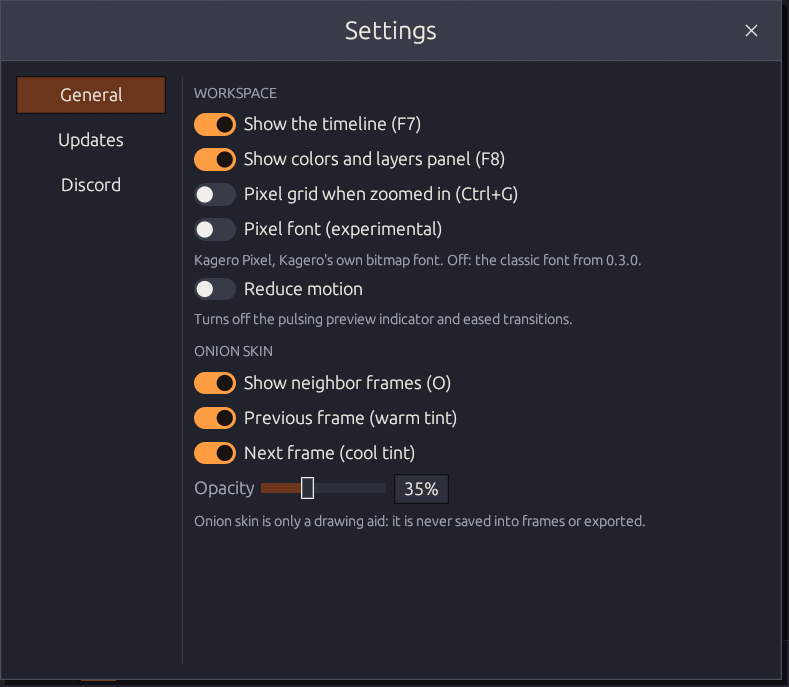
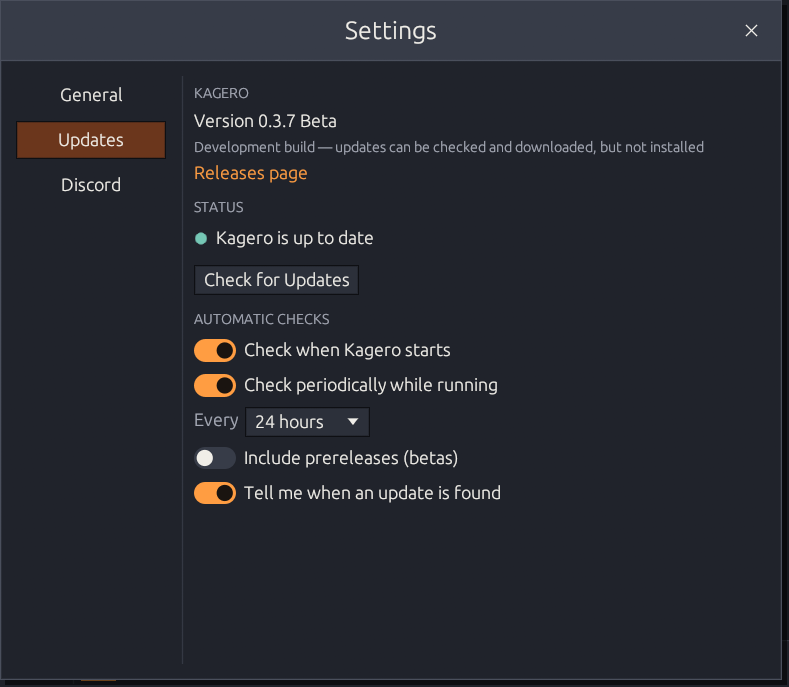
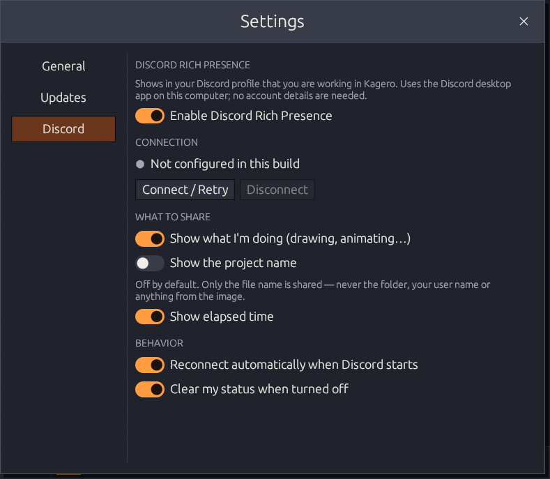

# Settings

**File → Settings…** or <kbd>Ctrl</kbd>+<kbd>,</kbd>. Changes apply immediately and are
saved automatically.



<figure><figcaption></figcaption></figure>

**Workspace**

* Show the timeline (<kbd>F7</kbd>) and the colors & layers panel (<kbd>F8</kbd>)
* Pixel grid when zoomed in (<kbd>Ctrl</kbd>+<kbd>G</kbd>)
* **Pixel font (experimental)** — Kagero Pixel, Kagero's own bitmap font, for the
  whole interface. Off by default.
* **Reduce motion** — turns off the pulsing preview badge and eased transitions

**Onion skin** — show neighbor frames (<kbd>O</kbd>), previous (warm) and/or next
(cool), opacity 5–90 %.



<figure><figcaption></figcaption></figure>

* Current version and build type, **Check for Updates**, download with progress,
  **Install and Restart**
* Check at startup and periodically (6/12/24/72 hours)
* Include prereleases (betas), notify me when an update is found
* **Restore Previous Version** after an update

How updating works: [Install & update](../getting-started/installation.md#update).



<figure><figcaption></figcaption></figure>

See [Discord Rich Presence](#discord-rich-presence) below.



## Discord Rich Presence

When the **Discord desktop app** runs on the same computer, Kagero can show what you're
doing in your Discord profile — no login, token or password.

| You are… | Discord shows |
|----------|---------------|
| On the start screen | *Browsing the Workshop* · *Ready to Create* |
| Editing a single image | *Creating Pixel Art* · *Editing a Sprite* |
| Editing an animation | *Animating Sprites* · *Animating* |
| Watching the preview | *Previewing Animation* · *Animating* |

…with the Kagero flame, an activity icon and the elapsed time.


**Private by default.** Kagero shares only the general activity. The project name is
shared only if you turn on **Show the project name** — and then only the file name,
never the folder, your Windows user name or anything from the image.


Options: enable/disable, show what I'm doing, show the project name, show elapsed time,
reconnect automatically when Discord starts later, clear my status when turned off,
and **Connect / Retry** / **Disconnect** with the connection status.

| Problem | Fix |
|---------|-----|
| *Not connected — Discord desktop app is not running* | Start the Discord app; the browser version can't be detected |
| Connected, but nothing in the profile | Discord → User Settings → *Activity Privacy* → share your activity |
| Discord runs as administrator | Run Kagero and Discord at the same permission level |

## Where settings are stored

`%APPDATA%\OnibiLab\Kagero\config.json` — recent files, palettes, layout, onion skin,
preview timing, export, update and Discord preferences. Deleting it resets everything;
a damaged file is ignored and replaced with defaults.
